<div align="center">

<picture>
  <source media="(prefers-color-scheme: dark)" srcset="logo/ate-logo-with-border.svg">
  
</picture>

# Agent Substrate

**Zero-trust sandboxing for millions of agents on Kubernetes.**

[](https://opensource.org/licenses/Apache-2.0)
[](https://github.com/agent-substrate/substrate/releases)
[](https://github.com/agent-substrate/substrate/actions/workflows/pr-workflow.yaml?query=branch%3Amain)
[](https://github.com/agent-substrate/substrate/actions/workflows/govulncheck.yaml)
[](https://github.com/agent-substrate/substrate/stargazers)

<a href="https://trendshift.io/repositories/34772"></a>

[Quickstart](#quickstart-development) · [Security](docs/security/security.md) · [Architecture](docs/concepts/architecture.md) · [Contributing](CONTRIBUTING.md)

<a href="https://ate.dev">
  
</a>

</div>

## What is Agent Substrate?

Agent Substrate is a security-hardened, zero-trust runtime for sandboxed agents, engineered to safely run millions of agents and tools with 10x higher density than standard containers. Purpose-built for the era of autonomous agents, Substrate delivers fast resume operations in less than 500ms, with more than 500 activations per second. Agents get isolated compute, identity, networking, and storage. Sensitive credentials are kept out of reach from untrusted code. It supports multiple sandbox technologies, including microVMs and gVisor, while enabling a consistent lifecycle and management of all sandboxes.

At its core, Agent Substrate maps a larger set of “actors” (stateful workloads such as agents) onto a smaller pool of ready “workers”. Because agents spend most of their lives waiting on models, tools, or humans, Substrate snapshots idle actors out of memory and restores them when a request arrives.

Substrate is a low-opinion runtime, not an agent SDK. The workloads it runs do not have to be AI agents, though autonomous, untrusted, mostly-idle agents are the target for its isolation and scheduling model. It runs on standard Kubernetes: Pods, autoscaling, NetworkPolicies. It adds agent-specific scheduling, snapshotting, identity, and network mediation. This allows agentic, inference, training, and reinforcement learning workloads to share one infrastructure plane.

## Security Model

Substrate treats every actor as untrusted and mutually hostile, so tenants can share physical nodes without sharing a security boundary. Every control operates within the cold-start and resume budget. See the [Security Guide](docs/security/security.md) for the full list of security principles and threat model.

* **Always sandboxed, VM-grade boundaries:** Every actor runs inside a dedicated [gVisor](https://gvisor.dev/) (`runsc`) or [Cloud Hypervisor](https://www.cloudhypervisor.org/) microVM sandbox with segregated compute, network, and storage. Plain Linux containers are not supported.
* **Per-agent cryptographic identity:** Every active actor receives a short-lived [SPIFFE](https://spiffe.io/) X.509 certificate by default, and the egress gateway can mint per-actor JWTs on demand when an egress policy calls for one. Both carry the actor identity and atespace (the Substrate namespace grouping), and are designed to federate with external identity systems.
* **Zero credentials in the sandbox:** Actors never hold actor identity JWTs/certs, API keys, or cloud tokens. The built-in egress gateway ([`atenet-egress`](docs/guides/egress-credential-injection.md)) injects credentials into approved outbound requests outside the sandbox, so a prompt-injected or compromised agent has nothing to exfiltrate.
* **Default-deny networking:** Actors start with a private network stack, no inbound path except through the ingress router (`atenet-router`), no lateral actor-to-actor or control-plane access, and outbound traffic [restricted by the egress gateway](docs/guides/egress-traffic.md).
* **Pluggable policy at the edge:** The egress gateway acts as an external Policy Enforcement Point (PEP) that is fully replaceable, allowing you to attach your own authorization, DLP, prompt-injection scanning, or cloud IAM policy engine without placing policy code inside the untrusted sandbox.

## Performance & Multiplexing

[](https://www.youtube.com/watch?v=ZEzkCFJkzjY)

*Watch the Agent Substrate cluster multiplex ~250 stateful actors across just 8 physical pods.*

This demo highlights the core developer experience and "Agentic Infrastructure" capabilities of Substrate:

1. **Actor Teleport:** Suspend and resume actors onto any available worker in the pool, when needed.
2. **Full-State Persistence:** Working memory (RAM) and filesystem state are captured in snapshots and restored intact across hibernation cycles, without losing in-flight sessions or tool state.
3. **10x–30x Oversubscription:** Multiplex a large registry of stateful actors onto a small pool of warm worker pods, paying for compute only while an agent is actively thinking or executing a tool.

To reproduce this demo in your own cluster, see the **[Counter Demo](demos/counter/README.md)**. For more walkthroughs, visit the **[agent-substrate YouTube channel](https://www.youtube.com/channel/UCN9PPqlTtVxlcpbQ-NWpfZQ)**.

## Star History

<a href="https://www.star-history.com/?repos=agent-substrate%2Fsubstrate&type=date&legend=top-left">
  <picture>
    <source media="(prefers-color-scheme: dark)" srcset="https://api.star-history.com/svg?repos=agent-substrate/substrate&type=date&theme=dark&legend=top-left">
    
  </picture>
</a>

## Framework Agnostic & Compatibility

Agent Substrate is **framework and agent harness agnostic**. Because it runs standard OCI container images inside gVisor or microVM sandboxes and enforces security outside the workload, it hosts agents built on any stack without SDK changes:

* **Agent Development Kit (ADK):** Preserves session state across invocations as actor state.
* **LangChain:** Drop-in execution environment for LangChain agents and tool calls.
* **Claude Code, Codex, and Antigravity:** High-density, stateful coding environments that keep system and filesystem state across sessions while isolating untrusted code execution.
* **Model Context Protocol (MCP):** Deploy sandboxed MCP servers as Substrate Actors with per-actor identity and egress controls.

## Ecosystem & Examples

*   **[Agent Executor](https://github.com/google/ax):** A distributed agent runtime that demonstrates building a secure, hyper-scalable agent harness on Agent Substrate (see the [announcement blog](https://cloud.google.com/blog/products/ai-machine-learning/agent-executor-googles-distributed-agent-runtime) and [integration guide](https://github.com/google/ax#2-deploy-the-control-plane)).
*   **[kagent](https://github.com/kagent-dev/kagent):** A CNCF Sandbox project and Kubernetes-native framework for building, deploying, and managing AI agents that uses Agent Substrate to run sandboxed, stateful agent workloads (see the [announcement blog](https://kagent.dev/blog/the-future-of-kagent)).

## Status and compatibility

Agent Substrate is pre-1.0.  We are not making any guarantees about backward
compatibility at this stage, and APIs and behavior may still change
significantly.

### Supported Kubernetes Releases

Currently we aim to support the [latest stable release](https://kubernetes.io/releases/) of Kubernetes, and the previous minor release.

## Community

For announcements, technical discussions, and community support, please join
the **[ate-dev](https://groups.google.com/g/ate-dev)** Google Group.

We host a weekly community meeting every Thursday from 10:00am - 11:00am PST.
- Video call link: https://meet.google.com/uhq-cxvn-dhy
- Or dial: (US) +1 253-289-6971 PIN: 787 664 574 59#
- More phone numbers: https://tel.meet/uhq-cxvn-dhy?pin=9044088223662
- [Meeting notes](https://docs.google.com/document/d/1obSIvfcafLNniLYTQCcT2eCgxHqa2AQ3Ga7YTsju49s) for the weekly sync meeting
- [Recordings and transcripts](https://drive.google.com/corp/drive/u/0/folders/1rX1S6vPxPrR8dA1lEBuBEXkGKjHtG-mL) of all community meetings

We also have channels in the CNCF slack; [request an invite here](https://slack.cncf.io/)
if you don't have access.

- [#substrate-users](https://cloud-native.slack.com/archives/C0B6RCAJULW) to discuss using substrate.
- [#substrate-dev](https://cloud-native.slack.com/archives/C0B6M3E2J3D) to discuss developing substrate.

## Developing

Please see [CONTRIBUTING.md](CONTRIBUTING.md) for guidelines on contributing to
the project.  We welcome contributions of all kinds, but the project is VERY
young.  Our immediate focus is on building out the core system and demos, so we
may not be able to review or merge contributions that don't align with those
goals in the near term.

## Quickstart (Development)

To quickly set up the complete environment:

1. Make sure you have [Go](https://go.dev/doc/install), [`kubectl`](https://kubernetes.io/docs/tasks/tools/), and [`docker`](https://www.docker.com/) installed and configured on your dev machine. We will automatically manage other dependencies via Go, including [`kind`](https://kind.sigs.k8s.io/).
   A Linux host that will run more than about a thousand sandboxes also needs a larger kernel neighbor table (`net.ipv4.neigh.default.gc_thresh1/2/3` = 4096/16384/32768); `hack/create-kind-cluster.sh` warns when the host is at the default of 1024.

2. Run the following steps:
```shell
# create cluster and local registry
hack/create-kind-cluster.sh

# make ate-setup target the kind cluster; set this in every shell that runs
# ate-setup, including for the demo walkthroughs
export ATE_INSTALL_KIND=true

# install Substrate
go run ./cmd/ate-setup deploy ate-system --credential-provider='{"name":"k8s.io"}' \
  --ingress-allowed-spiffe-ids=spiffe://cluster.local/ns/ate-system/sa/atenet-client

# install counter demo
go run ./cmd/ate-setup deploy demo counter

# install kubectl-ate
go install ./cmd/kubectl-ate

# create a counter actor in the demo's atespace (--template names the
# actor template, resolved in the actor's atespace)
kubectl ate create actor my-counter-1 -a ate-demo-counter --template counter

# serve a local proxy on port 8000 that sends requests to the actor through the
# network router
kubectl ate proxy actor my-counter-1 -a ate-demo-counter
```

> [!IMPORTANT]
> `{"name":"k8s.io"}` deploys the bundled credential provider with an empty,
> default-deny namespace policy. Before an actor can have a credential
> injected, grant its atespace the namespaces whose Secrets it may read; see
> [Enable it](docs/guides/egress-credential-injection.md#enable-it).

3. In a **separate terminal**, send an HTTP request to increment the counter:
```shell
curl -X POST -i http://localhost:8000/
```

### GKE Quickstart (Development)

1. Create and configure your environment file:
   ```bash
   cp hack/ate-dev-env.sh.example .ate-dev-env.sh

   # Edit .ate-dev-env.sh to match your project and preferences, then source it:
   source .ate-dev-env.sh
   ```

2. Enable application-default credentials for gcloud:
   ```bash
   gcloud auth application-default login --project=${PROJECT_ID}
   ```

3. Provision the required GCP resources (GKE cluster, GCS, and IAM bindings)
   with [`tools/setup-gcp`](https://github.com/ai-on-gke/substrate-gke/tree/main/tools/setup-gcp) in the
   [substrate-gke](https://github.com/ai-on-gke/substrate-gke) repository, which holds the GKE
   setup and teardown tooling. Its `bootstrap` command also creates the Workload
   Identity IAM grants that ate-api-server and atelet depend on. See
   [what `create iam` actually grants](https://github.com/ai-on-gke/substrate-gke/blob/main/tools/setup-gcp/README.md#what-create-iam-actually-grants)
   to audit them or apply them manually.

   If you bring your own cluster instead, it needs the PodCertificateRequest and
   ClusterTrustBundle APIs, which GKE 1.37 and higher serve by default. On 1.36,
   enable them as beta APIs, then replace any 1.36 node pools created before
   that. See the [Create Cluster warning](https://github.com/ai-on-gke/substrate-gke/blob/main/tools/setup-gcp/README.md#2-create-cluster).

4. Deploy the Agent Substrate system to your cluster:
   ```bash
   go run ./cmd/ate-setup deploy ate-system --credential-provider='{"name":"k8s.io"}' \
     --ingress-allowed-spiffe-ids=spiffe://cluster.local/ns/ate-system/sa/atenet-client
   ```

   `--ingress-allowed-spiffe-ids` lists the clients the router lets reach
   actors. The ID above is the one `kubectl ate proxy actor` presents. Without
   the flag no client reaches actors. See
   [Ingress to actors](docs/guides/operator-install.md#ingress-to-actors).

   `--credential-provider` is required. `{"name":"k8s.io"}` also deploys the
   bundled Kubernetes Secrets provider, with a NetworkPolicy that admits only
   the egress gateway; `{"enabled":false}` turns egress credential injection off
   (see [docs/guides/egress-credential-injection.md](docs/guides/egress-credential-injection.md)).
   `ATE_CREDENTIAL_PROVIDER` in `.ate-dev-env.sh` is the same choice.

   **Credential injection needs a namespace policy.** The bundled provider
   starts with an empty, default-deny one, so it resolves no Secrets until you
   grant each atespace the namespaces it may read; see
   [Enable it](docs/guides/egress-credential-injection.md#enable-it).

5. You can then deploy the sample applications. See [demos/counter/README.md](demos/counter/README.md) or [demos/sandbox/README.md](demos/sandbox/README.md) for detailed walkthroughs.
   ```bash
   go run ./cmd/ate-setup deploy demo counter
   ```

#### Custom Setup and Deployment

To create individual GCP resources, or to run the PostgreSQL store backend on
Cloud SQL, see [`tools/setup-gcp`](https://github.com/ai-on-gke/substrate-gke/tree/main/tools/setup-gcp) in substrate-gke.

You can deploy or cleanup specific Agent Substrate components using
the installation script. See `go run ./cmd/ate-setup` for all options.
```bash
# Re-deploy only ate-apiserver of the ATE system
go run ./cmd/ate-setup deploy apiserver

# Delete everything (core system and all demos)
go run ./cmd/ate-setup delete all
```

#### Tearing down resources (GCP)

To delete the GCP resources, run substrate-gke's
[`tools/setup-gcp/teardown.sh`](https://github.com/ai-on-gke/substrate-gke/blob/main/tools/setup-gcp/README.md#teardown). It deletes resources
in the reverse order of creation and handles partial failures.

* `--all` deletes everything, including the dashboards, the snapshot transfer service account and the project-level IAM bindings, which every Substrate cluster in the project shares.
* `--cluster-scoped` deletes only this cluster, its buckets and the bindings on them. Use it while other Substrate clusters still use the project.

#### Tearing down local `kind` resources

If you need to delete the local `kind` cluster and its registry (if it was created by `hack/create-kind-cluster.sh`):

```bash
./hack/delete-kind-cluster.sh
```

## Demos

We provide several sample applications demonstrating Agent Substrate's capabilities:

1. **[Counter Demo](demos/counter/README.md)**: A stateful Go HTTP server demonstrating state preservation across suspends/resumes, and on-demand actor resumption and routing via the Substrate router.
2. **[Sandbox Demo (Antigravity)](demos/sandbox/README.md)**: A secure, sandboxed execution environment (running Alpine Linux) that allows arbitrary shell execution while preserving filesystem state across sessions.
3. **[Claude Code Multiplex](demos/claude-code-multiplex/README.md)**: Demonstrates oversubscribing physical hardware by multiplexing multiple Claude Code agents onto a limited pool of workers.
4. **[Multi-Template](demos/multi-template/README.md)**: Two `ActorTemplate`s running different binaries share one `WorkerPool`, even though the templates live in different atespaces.
5. **[Request Parking](demos/parking/README.md)**: An oversubscribed pool where the router holds inbound requests until a worker frees up, instead of returning `503`.

### Documentation & Guides
* [Architecture](docs/concepts/architecture.md): How the control plane, node supervisor, and networking stack fit together.
* [API Configuration Guide](docs/reference/api-guide.md): Detailed reference for configuring WorkerPools, ActorTemplates, Secrets, and Volumes.
* [Full CLI Documentation](docs/reference/kubectl-ate.md): Installation and usage for `kubectl-ate`.
* [Glossary](docs/reference/glossary.md): Core terms (Actor, Atespace, ActorTemplate, WorkerPool, Worker, ate-api-server, atenet, atelet, ateworker) and how they relate.
* [Integration Repositories](docs/project/integration-repos.md): Where integrations live, how their repositories are named, and how fixes flow back to core.
* [Observability Guide](docs/guides/observability.md): Guide to actor logging, metrics, and distributed tracing.
* [Extending Substrate](docs/security/extensibility.md): How to augment or replace the built-in ingress and egress gateways.
* [Authentication Guide](docs/guides/authentication.md): Configure trusted JWT providers and human credentials.
* [Egress Traffic](docs/guides/egress-traffic.md): Which protocols an Actor may reach the outside world with and which are blocked.
* [Enabling man-in-the-middle (MITM) interception for Actor Egress policy](docs/guides/egress-trust-bundle.md): Egress policies such as header injection depend on MITM interception of Actor traffic. This guide explains how an Actor should be configured to enable interception.
* [Request Parking](docs/concepts/request-parking.md): How the router parks requests through transient worker-pool saturation.
* [Sandbox Asset Cache](docs/concepts/sandbox-asset-cache.md): How a node caches the sandbox binaries actors run on, decides which runtimes it needs, and evicts to a budget.
* [Upgrade Runbook](docs/guides/upgrade.md): Upgrade a running install to a newer supported release, and roll back if needed.
* [Node Storage](docs/guides/node-storage.md): How to give snapshot I/O its own disk.
* [Security Guide](docs/security/security.md): Security overview, security principles, and threat modeling.
* [Benchmarking Guide](docs/guides/benchmarking.md): Locust-based load tests, monitoring stack, and the orchestrated benchmark harness.

## Tour

### Commands

* `cmd/ateapi`: The core control plane API server exposing gRPC endpoints to manage actor and worker lifecycles.
* `cmd/atelet`: A node-level DaemonSet that supervises physical worker pods, coordinates snapshotting, and manages state transfers.
* `cmd/atecontroller`: A Kubernetes controller that reconciles WorkerPool custom resources.
* `cmd/ate-idp-server`: Serves the OpenID discovery document and key set that relying parties use to verify actor JWTs.
* `cmd/atenet`: A combined networking controller providing Envoy routing and proxy sidecars.
* `cmd/ateworker-gvisor`: An interior-pod helper running inside sandboxed worker pods to execute `runsc` checkpoint and restore commands.
* `cmd/ateworker-microvm`: The microVM peer of `ateworker-gvisor`, running actors as cloud-hypervisor VMs.
* `cmd/podcertcontroller`: A "polyfill" that provides Pod Certificate signers that
  will eventually ship in upstream Kubernetes (with different names).
* `cmd/kubectl-ate`: A CLI tool for managing Agent Substrate resources. See its [README](docs/reference/kubectl-ate.md).
* `cmd/benchmarking`: Synthetic workloads used by the load tests, including `glutton`, which consumes RAM, disk, and file descriptors on demand.
* `demos/`: Sample applications demonstrating Agent Substrate capabilities.
