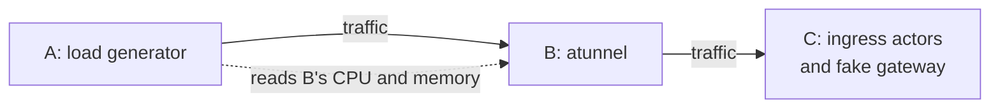
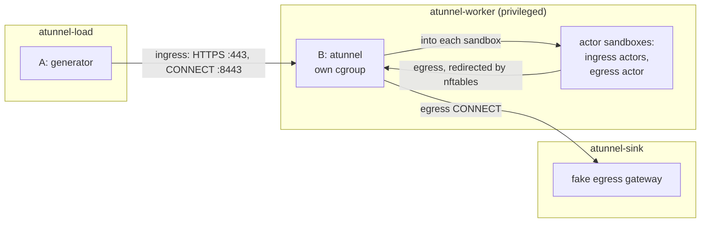

# atunnel benchmark

Measures what atunnel, the per-worker ingress and egress tunnel, costs in CPU
and memory as load rises. atunnel is started and hosts its actors with the
worker's own code, in a process of its own, so the numbers are atunnel's alone.



The generator (A) sends traffic through atunnel (B) to fakes of what atunnel
talks to in a cluster (C). A reads B's CPU and memory as it goes and prints a
table per scenario.

## Running

Linux containers only: atunnel creates real network namespaces and nftables
rules, so its container is privileged. On macOS, Docker Desktop provides the
Linux.

```sh
benchmarking/atunnel/run-docker.sh                                 # atunnel at 1 CPU, 1 GiB
benchmarking/atunnel/run-docker.sh --tunnel-cpus 2 --tunnel-memory 2g -- --rungs 2000,4000,8000
benchmarking/atunnel/run-docker.sh --cpuset-worker 0-3 --cpuset-rig 4-9 -- --scenarios Connect
```

Options before `--` shape the containers (`--tunnel-cpus`, `--tunnel-memory`,
`--actors`, `--cpuset-worker`, `--cpuset-rig`); everything after goes to
`atunnel-bench load` (`--scenarios`, `--rungs`, `--step`, `--warmup`, `--workers`).

Each run writes to `benchmarking/atunnel/runs/<timestamp>/`:
`results.txt`, `results.json`, `profiles/` (a CPU and a heap profile of atunnel
per rung), and `logs/`. Only `results.txt`, and a `report.md` if you write
one, are kept in git. Open a profile with
`go tool pprof -http=: runs/.../profiles/IngressH1-4000.cpu.pb.gz`.

## How it works

The benchmark is one program, `atunnel-bench`, with a subcommand per process.
`run-docker.sh` runs it in three containers on one Docker network:



Which subcommand runs where:

| Subcommand | Container | Runs |
|---|---|---|
| `worker` | `atunnel-worker` | the rest of the worker pod: the fake atelet, `tunnel` in its own cgroup, and the actors in the sandboxes |
| `tunnel` | `atunnel-worker`, started by `worker` | atunnel, hosting actors with the worker's own code: the process measured |
| `ingress-actor`, `egress-actor` | `atunnel-worker`, inside the sandboxes | the actors' stand-ins, started by `worker` |
| `sink` | `atunnel-sink` | the fake egress gateway |
| `load` | `atunnel-load` | the load generator |
| `pki` | run once, before the containers | the throwaway certificates the others share |

### What is real

`atunnel-bench tunnel` makes the calls `cmd/ateworker-gvisor` makes, in the
same order:
- at startup: `tunnel.Start` with the worker's own flags, through
  `tunnel.RegisterFlags`;
- per actor: `tunnel.PrepareEgress`, `actornet.ServeSandbox`, and
  `tunnel.Activate`;
- at teardown: `tunnel.Deactivate`, then closing the sandbox network.

Each actor gets real network namespaces, the nftables redirect, an egress
listener and DNS relay in its sandbox, and a certificate minted through
atunnel's own atelet client.

### What is faked

| In a worker | Stand-in |
|---|---|
| atelet | `worker` serves the two atelet calls atunnel makes, certificate minting and egress policy |
| the actor's program receiving requests | an ingress actor: a small HTTP server in each sandbox |
| the actor's program making outgoing connections | an egress actor in each sandbox; EgressIdleConns splits its connections across them, the other egress scenarios use actor-0's |
| the router | the generator, presenting the router's identity |
| the egress gateway | `sink`, with the real gateway's Envoy HTTP/2 settings; it never dials out |
| Pod certificates | files from a throwaway CA |

### How atunnel is measured

- atunnel runs in its own cgroup with the CPU and memory limits and no swap,
  so going over the limit is an OOM kill, as in a pod. The actors run outside
  it. If atunnel dies, `worker` logs it and starts a fresh one.
- The generator is open loop: work is scheduled at a fixed rate whatever
  earlier requests take, and latency is measured from when each unit was due.
- For each rung, the generator reads atunnel's `/stats` (CPU, memory,
  goroutines) when the warmup ends, every 500 ms after, and when the rung ends.
- atunnel's process also holds the other subcommands' code, which it never
  runs. That costs about 3 MB: atunnel idles at about 29 MB hosting 10 actors,
  against 26 MB built on its own.

## Scenarios

Each scenario runs at every rate in `--rungs` (default `1000,2000,4000,8000`
per second), for `--step` (10s) each, leaving the first `--warmup` (2s) out.

The router reaches atunnel in one of two ways, set by its `--upstream-connect`
flag: through CONNECT tunnels (the default), or over HTTPS (`false`).

| Scenario | Router mode | What is sent | Tells you |
|---|---|---|---|
| IngressH1 | `--upstream-connect=false` | HTTPS GETs over HTTP/1.1 keep-alive to `:443`, the `ate-target-actor` header cycling over the actors | CPU per request through atunnel's reverse proxy |
| IngressH2 | `--upstream-connect=false` | the same over HTTP/2 | the same, multiplexed |
| Connect | default | per unit: new TLS connection to `:8443`, `CONNECT actor:80`, one GET inside | cost of setting up a tunnel, mostly the TLS handshake |
| EgressHTTP | either | plain HTTP keep-alive from inside a sandbox | CPU per egress request on reused connections |
| EgressNewConnection | either | the same with a new connection per request | cost of a new egress connection |
| EgressIdleConns | either | rungs are connection counts: open at 200/s, one request each, hold | memory per open tunnel, read after a GC |
| EgressTCP | either | 4 connections write 64 KiB chunks as fast as they can; first rung only | throughput and CPU per byte |

## Caveats

- **Not covered:** gVisor itself, the real router and gateway, and actors being
  activated and deactivated during load.
- **Shared machine.** The containers share the Docker host's CPUs. Pin them
  apart with `--cpuset-worker` and `--cpuset-rig` for clean capacity numbers.
- **Ephemeral ports.** Connect and EgressNewConnection leave tens of thousands
  of sockets in TIME_WAIT. `run-docker.sh` widens the port range and enables
  `tcp_tw_reuse` in its containers, and the egress actor does the same in its
  sandbox.
- **Heap figures** are Go's `HeapInuse`; for what is live, see the
  EgressIdleConns line, which collects garbage first.
