# Nighthawk Egress Benchmark

Benchmarks the Agent Substrate egress dataplane (`atunnel` -> `atenet-egress`) using [Nighthawk](https://github.com/envoyproxy/nighthawk).

## Architecture

```mermaid
flowchart LR
    client["nighthawk_client<br/>(host)"]
    invoker["traffic-driver-invoker<br/>(:19980, adds ate-target-actor)"]
    router["atenet-router<br/>(:443)"]

    subgraph worker["WorkerPod (ateworker-gvisor)"]
        atunnel-ingress["ingress atunnel"]
        actor["Actor: nighthawk/tester<br/>(nighthawk_service :80)"]
        atunnel-egress["egress atunnel"]
    end

    egress["atenet-egress<br/>(HTTP / HTTPS MITM / TLS passthrough)"]
    server["nighthawk-server<br/>(:80, :443, :8443)"]

    client -->|"start test"| invoker
    invoker -->|"gRPC + ate-target-actor: nighthawk/tester"| router
    router --> atunnel-ingress
    atunnel-ingress --> actor
    actor ==>|"test traffic"| atunnel-egress
    atunnel-egress ==>|"mTLS"| egress
    egress ==> server
```



## Prerequisites

To measure single CPU performance characteristics of Envoy dataplane set E2E_ATE_ENVOY_CONCURRENCY=1 environment
variable when deploying ATE.

1. **Cluster with Agent Substrate deployed**:
   - **Existing cluster** (with `.ate-dev-env.sh` configured):
     ```bash
     hack/install-ate.sh deploy ate-system \
       --credential-provider='{"name":"k8s.io"}' \
       --ingress-allowed-spiffe-ids=spiffe://cluster.local/ns/nighthawk/sa/default
     ```
   - **Local `kind` cluster**:
     ```bash
     hack/install-ate-kind.sh deploy ate-system \
       --credential-provider='{"enabled":false}' \
       --ingress-allowed-spiffe-ids=spiffe://cluster.local/ns/nighthawk/sa/default
     ```
   - To set the `atenet-egress` Envoy worker thread count (`--concurrency`), set `E2E_ATE_ENVOY_CONCURRENCY` when deploying:
     ```bash
     E2E_ATE_ENVOY_CONCURRENCY=1 hack/install-ate-kind.sh deploy ate-system --credential-provider='{"name":"k8s.io"}' --ingress-allowed-spiffe-ids=spiffe://cluster.local/ns/nighthawk/sa/default
     ```
   - Provision CA bundle which includes cluster's trust bundle, so that egress gateway can trust nighhawk's test server cert, run:
     ```bash
     hack/setup-e2e-egress-tls-kind.sh
     ```
2. **`kubectl-ate` installed in `PATH`**:
   ```bash
   go install ./cmd/kubectl-ate
   ```
3. **Docker** running locally (used to run `nighthawk_client`).

## Setup

### 1. Deploy `nighthawk-server` and `traffic-driver-invoker`

```bash
./benchmarking/nighthawk-egress/deploy.sh
```

### 2. Deploy the worker pool, actor template, and `nighthawk/tester` actor

```bash
./benchmarking/nighthawk-egress/deploy-traffic-driver.sh
```

### 3. Port-forward `traffic-driver-invoker`

In a separate terminal, forward local port `19980` to the `traffic-driver-invoker` service:

```bash
kubectl -n ate-system port-forward svc/traffic-driver-invoker 19980:19980
```

## Running the Benchmark

Run `nighthawk_client` against the port-forwarded `traffic-driver-invoker` endpoint (`grpc://127.0.0.1:19980`), which routes the gRPC request to `nighthawk_service` inside the `nighthawk/tester` actor:

```bash
docker run --rm --network=host --entrypoint /usr/local/bin/nighthawk_client envoyproxy/nighthawk-dev:latest --nighthawk-service grpc://127.0.0.1:19980 --rps 1000 --concurrency 1 --protocol http1 --duration 60  http://nighthawk-server.ate-system.svc:80
```

See [Nighthawk CLI help](https://github.com/envoyproxy/nighthawk#using-the-nighthawk-client-cli) for all command line options.

### Target URLs and Default Egress Policy

| Egress Mode | Target URL | Port |
|---|---|---|
| Plaintext HTTP | `http://nighthawk-server.ate-system.svc:80` | `80` |
| HTTPS (TLS MITM) | `https://nighthawk-server.ate-system.svc:443` | `443` |
| TLS Passthrough | `https://nighthawk-server.ate-system.svc:8443` | `8443` |

## Cleanup

Delete the `nighthawk/tester` actor, actor template, atespace, and worker pool:

```bash
./benchmarking/nighthawk-egress/deploy-traffic-driver.sh --delete
```

Delete `nighthawk-server` and `traffic-driver-invoker` from `ate-system`:

```bash
./benchmarking/nighthawk-egress/deploy.sh --delete
```
