# Nighthawk Egress Benchmark

Benchmarks the Agent Substrate egress dataplane (`atunnel` -> `atenet-egress`) using [Nighthawk](https://github.com/envoyproxy/nighthawk).

## Objective

For `http` / `mitm` egress mode, the benchmark finds the highest request rate that one `atenet-egress` replica carries with 1 CPU allocated for each of its `envoy` and `ext-proc` containers under 3 thresholds:

- `success-rate`: at least 99.8% of the sent requests get a 2xx response.
- `send-rate`: the client sends at least 90% of the scheduled requests.
- `latency-ns-mean-plus-2stdev`: the latency mean plus two standard deviations is at most 25 ms.

## What it measures

```mermaid
flowchart LR
    subgraph job["Runner Job"]
        client["Nighthawk client"]
        invoker["invoker sidecar<br/>(:19980, adds ate-target-actor)"]
    end
    router["atenet-router"]

    subgraph worker["WorkerPod (ateworker-gvisor)"]
        atunnel-ingress["ingress atunnel"]
        actor["Actor: nighthawk/tester<br/>(nighthawk_service :80)"]
        atunnel-egress["egress atunnel"]
    end

    egress["atenet-egress<br/>(HTTP / HTTPS MITM / TLS passthrough)"]
    server["nighthawk-server<br/>(:80, :443, :8443)"]

    client -->|"start test"| invoker
    invoker -->|"gRPC + ate-target-actor: nighthawk/tester"| router
    router --> atunnel-ingress
    atunnel-ingress --> actor
    actor ==>|"test traffic"| atunnel-egress
    atunnel-egress ==>|"mTLS"| egress
    egress ==> server
```



The test traffic follows the thick arrows:

- `nighthawk_service` inside the actor sends it.
- The egress `atunnel` of the worker pod and `atenet-egress` carry it.
- `nighthawk-server`: a `nighthawk_test_server` that answers each request with a 10-byte body.

The runner Job only starts each stage of the search.

Each suite uses one egress mode, `http` or `mitm`. [Target URLs and Default Egress Policy](#target-urls-and-default-egress-policy) lists the target URL of each mode.

A stage passes only when each of the three thresholds holds.

| Threshold | Purpose |
|---|---|
| `success-rate`: at least 99.8% of the sent requests get a 2xx response. | Detects fast errors, such as 503 and 504. |
| `send-rate`: the client sends at least 90% of the scheduled requests. | Detects scheduled requests that the client skips. |
| `latency-ns-mean-plus-2stdev`: the latency mean plus two standard deviations is at most 25 ms. | Detects a slow egress path. This threshold is the SLO. |

In the runs so far, the stages directly above the highest rate fail the latency threshold.

## How it works

One Kubernetes Job per `type: nighthawk-egress` tests.yaml entry, driven by [`../automation/orchestrator.py`](../automation/orchestrator.py). For each suite the orchestrator deploys Substrate with the `ateArgs` of the entry, then:

1. **Pin the gateway.** The orchestrator pins `deployment/atenet-egress` to 1 replica with `envoy` and `ext-proc` at 1 CPU each, and waits for the rollout.
2. **Deploy the rig.** `hack/setup-e2e-egress-tls-kind.sh` provisions the CA bundle so `atenet-egress` trusts the certificate of `nighthawk-server`. `deploy.sh` and `deploy-traffic-driver.sh` deploy `nighthawk-server`, the worker pool, the actor template, and the `nighthawk/tester` actor with its egress policy.
3. **Adaptive search.** The orchestrator submits one Job from `nighthawk-egress-runner-job.yaml.tmpl`. In the Job, `runner.py` builds the load spec for the mode (`spec.py`) and runs `nighthawk_adaptive_load_client` against `nighthawk_service` in the `nighthawk/tester` actor, through the `invoker` sidecar of the Job. The sidecar is an Envoy that adds the `ate-target-actor: nighthawk/tester` header and connects to `atenet-router` as `benchmarking/benchmark-runner`. The search doubles the rate until a stage fails a threshold, then narrows the range, and ends with one testing stage. [Search values](#search-values) gives the rates and the durations.
4. **Upload results** (see [Reading the results](#reading-the-results)). The runner uploads the files that exist before it exits. The Job fails in each of these cases:
   - The adaptive client exits non-zero, with no output. It does so when a stage ends with an error, the first stage fails a threshold, or the search passes its deadline.
   - The output of the client has no testing stage.
   - The runner raises an error.
   - An upload fails.

## How to run it

### In CI

The scheduled job in [benchmarking/automation](../automation/README.md) runs the two `type: nighthawk-egress` suites of [`benchmarking/automation/tests.yaml`](../automation/tests.yaml):

| Suite | `mode` |
|---|---|
| `egress_gatewaycap_http_1cpu` | `http` |
| `egress_gatewaycap_mitm_1cpu` | `mitm` |

The suites support gVisor only. Each suite passes `--cordon-system-infra-components` in `ateArgs`, so the cluster needs the node pools of [Sizing the rig](#sizing-the-rig). The entry of the `http` suite:

```yaml
- name: egress_gatewaycap_http_1cpu
  type: nighthawk-egress
  targetCluster: dev
  duration: 30m
  ateArgs:
    - "--cordon-system-infra-components"
  nighthawk-egress:
    mode: http
```

### Reading the results

The runner uploads these files to `<dest>/runs/<name>/run_date=<date>/run_ts=<ts>/run_tag=<tag>/`:

| File | Content |
|---|---|
| `capacity.json` | The verdict. `slo_max_rps` is the achieved rate of the highest stage that passed every threshold, and `slo_max_stage` names that stage. `binding_threshold` lists the thresholds that failed in any stage. The other keys are those of the [nighthawk-ingress](../nighthawk-ingress/README.md) summary, plus `mode`. The runner writes this file only when the search succeeds. |
| `status.json` | `adaptive_client_exit_code`, `slo_max_rps`, and `failures`, the reasons why the run does not count. A failed upload of `status.json` itself is in the Job log only. |
| `stats.jsonl`, `results.json` | One record for each stage, and the Nighthawk output as JSON. |
| `spec.textproto`, `output.textproto`, `logs.txt` | The load spec, the raw Nighthawk output, and the client log. |

#### Limitations

Nighthawk starts its latency clock when it sends a request, so the latency does not count the wait for a free connection. A run does not record the CPU use of the gateway, so a result that `send-rate` sets does not show by itself that the gateway was the limit.

## Tuning

### Configuration knobs (the `nighthawk-egress:` block)

A `type: nighthawk-egress` entry in [`benchmarking/automation/tests.yaml`](../automation/tests.yaml) sets one knob in its `nighthawk-egress:` block:

| Knob | Default | Meaning |
|---|---|---|
| `mode` | required | `http`, `mitm`, or `passthrough`. |

The gateway size is not a knob. The orchestrator gives `envoy` and `ext-proc` of `deployment/atenet-egress` a CPU request and limit of 1 each and starts Envoy with `--concurrency 1`. [Sizing the rig](#sizing-the-rig) sizes the load for that gateway.

### Search values

The thresholds of [What it measures](#what-it-measures) and these search values are constants in [`spec.py`](spec.py):

| Constant | Value | Meaning |
|---|---|---|
| `DEFAULT_CONCURRENCY` | 16 | Nighthawk event loops of `nighthawk_service` in the actor. |
| `DEFAULT_CONNECTIONS` | 16 | Client connections of each event loop, 256 in total. |
| `DEFAULT_MAX_PENDING` | 32 | Requests of each event loop that can wait for a free connection. The client does not send a request beyond this number and counts it in `pool_overflow`, which lowers `send-rate`. |
| `DEFAULT_INITIAL_RPS` | 500 | Start rate in requests per second in total. Nighthawk rounds it down to 31 for each event loop, 496 in total. |
| `DEFAULT_EXP_FACTOR` | 2 | Multiplies the rate after each stage that passes, until a stage fails. |
| `DEFAULT_MEASURING_PERIOD_S` | 20 | Length in seconds of each stage before the testing stage. |
| `DEFAULT_CONVERGENCE_DEADLINE_S` | 600 | Total time in seconds of the stages before the testing stage. |
| `DEFAULT_TESTING_STAGE_S` | 60 | Length in seconds of the last stage, at the rate where the search converged. |

### Sizing the rig

The actor, the worker pool, and `nighthawk-server` are sized to outscale `atenet-egress` with one Envoy worker thread, so a run measures the gateway and not the load generator or the origin server. `--cordon-system-infra-components` keeps the gateway off the nodes that run the load. The cluster needs the two tainted node pools of [System Infra Isolation](../../docs/concepts/architecture.md#system-infra-isolation) and a default pool:

| Node pool | Example size | Runs | Kept there by |
|---|---|---|---|
| `ate-system-infra` | 1 x `c3-standard-22` | `atenet-egress`, the system under test, beside the other system infra components, which carry no test traffic | the node selector and toleration that `--cordon-system-infra-components` adds |
| `ate-postgres` | 1 x `c3-standard-4` | Postgres | the same flag |
| default | 2 x `c3-standard-22` (22 vCPUs and 88 GiB each) | the worker pod with the `nighthawk/tester` actor, `nighthawk-server`, and the runner Job | the `NoSchedule` taints of the other two pools, which these pods do not tolerate |

The sizes:

- `traffic-driver-template.yaml.tmpl` gives the `nighthawk/tester` sandbox 16 vCPUs and 8 GiB, so `nighthawk_service` runs its 16 event loops without CPU throttling. The suites and the manual example command both use 16.
- `traffic-driver.yaml.tmpl` requests 12 vCPUs and 8 GiB for the worker pod and sets no limits, so only the actor's own limits cap the load generator. The request fits a `c3-standard-22` node beside the system DaemonSets. The worker pod and `nighthawk-server` request 18 vCPUs together, so the scheduler may place them on the same node; this benchmark accepts that.
- `nighthawk-server.yaml` runs `nighthawk_test_server` with `--concurrency 8` and requests 6 vCPUs, so upstream HTTP and TLS on `:80`, `:443`, and `:8443` do not saturate before the gateway.

## Manual runs

The rig also takes a fixed-rate run from a host, with no runner Job. `nighthawk_client` reaches `nighthawk_service` in the actor through `kubectl-ate proxy actor`.

### Prerequisites

1. **Multi-node benchmark cluster with Agent Substrate deployed**:
   - **Existing cluster** (with `.ate-dev-env.sh` configured):
     ```bash
     E2E_ATE_ENVOY_CONCURRENCY=1 go run ./cmd/ate-setup deploy ate-system \
       --cordon-system-infra-components \
       --credential-provider='{"name":"k8s.io"}' \
       --ingress-allowed-spiffe-ids=spiffe://cluster.local/ns/ate-system/sa/atenet-client
     ```
   - `E2E_ATE_ENVOY_CONCURRENCY` sets the `atenet-egress` Envoy worker thread count (`--concurrency`). `E2E_ATE_ENVOY_CONCURRENCY=1` measures a single Envoy core, which the sizes above are for.
   - Provision the CA bundle in `ate-system` so `atenet-egress` trusts `nighthawk-server`'s `servicedns` certificate on `:443`. The script defaults to a kind context, so name the cluster's context:
     ```bash
     KUBECTL_CONTEXT=<context> hack/setup-e2e-egress-tls-kind.sh
     ```
   - To run on a smaller cluster, lower `requests.cpu` and `requests.memory` in `traffic-driver.yaml.tmpl` and `nighthawk-server.yaml` before deploying. A worker pod without limits offers its node's allocatable CPU and memory to actors, so on nodes with fewer than 16 allocatable vCPUs also lower `cpuMillicores` in `traffic-driver-template.yaml.tmpl`. On a cluster without the two tainted pools, leave out `--cordon-system-infra-components`; the gateway then shares nodes with the load.
2. **`kubectl-ate`**: `deploy-traffic-driver.sh` builds it from `./cmd/kubectl-ate` into a temporary directory.
3. **Docker** running locally (used to run `nighthawk_client`).

### Setup

#### 1. Deploy `nighthawk-server`

```bash
./benchmarking/nighthawk-egress/deploy.sh
```

#### 2. Deploy the worker pool, actor template, and `nighthawk/tester` actor

```bash
./benchmarking/nighthawk-egress/deploy-traffic-driver.sh
```

#### 3. Forward a port to the actor

In a separate terminal, forward local port `19980` to `nighthawk_service` in the `nighthawk/tester` actor. `kubectl-ate proxy actor` connects as `spiffe://cluster.local/ns/ate-system/sa/atenet-client`, which is the ID in the deploy command above:

```bash
go run ./cmd/kubectl-ate proxy actor tester -a nighthawk 19980:80
```

### Running the benchmark

Run `nighthawk_client` against the forwarded port (`grpc://127.0.0.1:19980`), which reaches `nighthawk_service` inside the `nighthawk/tester` actor:

```bash
docker run --rm --network=host --entrypoint /usr/local/bin/nighthawk_client envoyproxy/nighthawk-dev:latest --nighthawk-service grpc://127.0.0.1:19980 --rps 1000 --concurrency 16 --protocol http1 --duration 60  http://nighthawk-server.nighthawk.svc:80
```

Nighthawk multiplies `--rps` by `--concurrency`, so this command targets 16,000 requests per second in total. One Envoy worker thread holds less than that, so the gateway saturates and the output shows the rate it reached.

See [Nighthawk CLI help](https://github.com/envoyproxy/nighthawk#using-the-nighthawk-client-cli) for all command line options.

#### Target URLs and Default Egress Policy

| Egress Mode | Target URL | Port |
|---|---|---|
| Plaintext HTTP | `http://nighthawk-server.nighthawk.svc:80` | `80` |
| HTTPS (TLS MITM) | `https://nighthawk-server.nighthawk.svc:443` | `443` |
| TLS Passthrough | `https://nighthawk-server.nighthawk.svc:8443` | `8443` |

### Cleanup

Delete the `nighthawk/tester` actor, actor template, atespace, and worker pool:

```bash
./benchmarking/nighthawk-egress/deploy-traffic-driver.sh --delete
```

Delete `nighthawk-server` from `nighthawk`:

```bash
./benchmarking/nighthawk-egress/deploy.sh --delete
```

Neither script deletes the `nighthawk` namespace. Delete it with `kubectl delete namespace nighthawk` after `deploy-traffic-driver.sh --delete`, because the actor, template, and atespace live in the ate API, not in the namespace.
