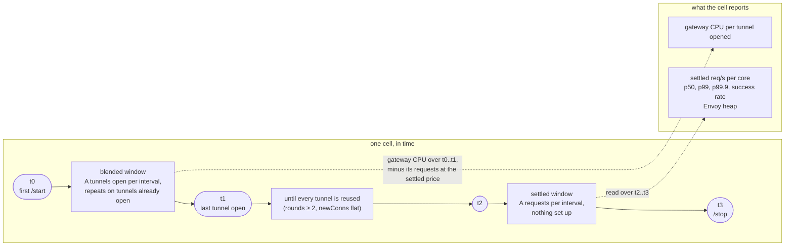
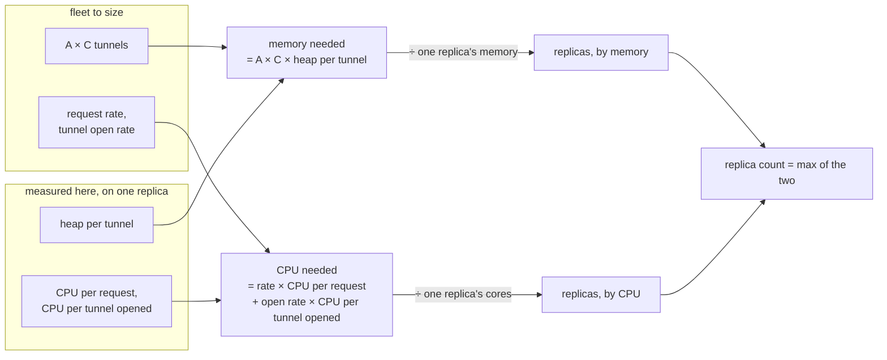
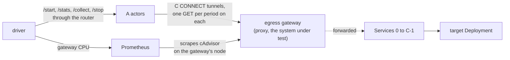
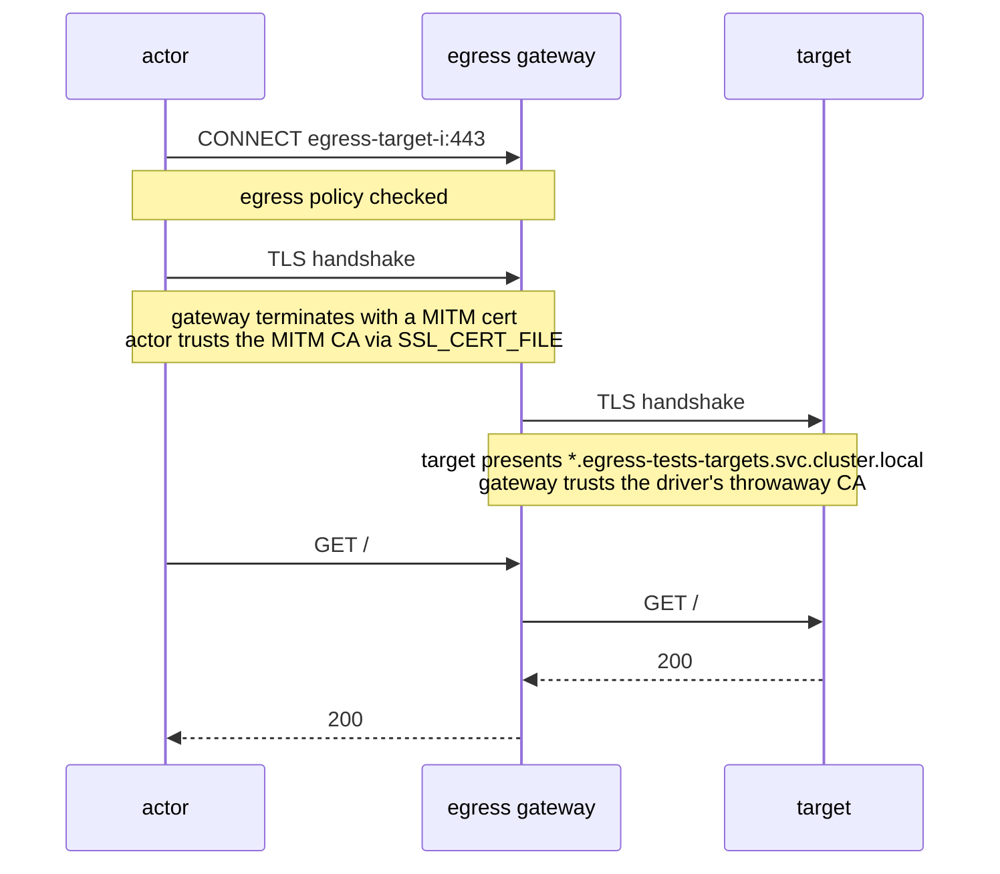
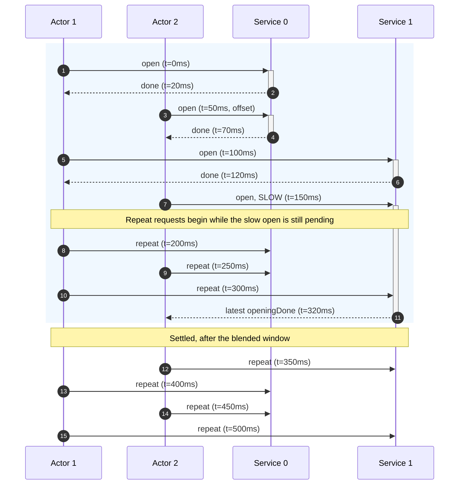

# benchmark-egress

`benchmark-egress` is the workload of the egress scale test. It holds many
CONNECT tunnels open through the egress gateway at a fixed pace and reports what
each tunnel saw, so that a run can price what one tunnel costs the gateway.

## 1. What the benchmark measures

The benchmark sizes one `atenet-egress` replica for a target fleet: A actors,
each reaching C destinations. It reports what one tunnel and one request cost
the gateway, so that the replica count for a fleet follows from fleet size,
one replica's CPU and memory, and these costs.

Three terms:

- **Tunnel.** One kept-alive CONNECT from one actor to one destination
  Service, opened by the actor's first request and reused by every later one.
  It is the unit the gateway's cost scales with: a fleet of A actors over C
  Services holds A × C tunnels.
- **Blended.** The window from the first actor's start until the last actor
  has opened its last tunnel. New tunnels are being set up while tunnels
  already open carry repeat requests, so the gateway's CPU mixes setup with
  ordinary requests.
- **Settled.** The period, after the blended window, in which every tunnel
  has been reused and every request reuses one. Nothing is set up; the
  gateway's cost is per request.

The settled period gives the cost of one request directly. The blended window
gives the cost of setting up one tunnel once its requests are priced at the
settled rate.



A cell is one fleet size and one protocol. It reports:

- **Settled req/s per core.** Throughput per gateway core once every tunnel
  exists. Its inverse is the CPU cost of one request.
- **Gateway CPU per tunnel opened.** CPU milliseconds to set up one tunnel, the
  cost of its requests taken out.
- **Envoy heap per tunnel.** KiB of heap one held tunnel adds.
- **Settled p50, p99, p99.9 and success rate.** Latency of repeat requests as
  the actor sees it, and the share that got HTTP 200. Flat across fleet sizes
  means the gateway was not saturated while the costs were read.

The costs price held tunnels, not tunnels that reconnect. Section 6 lists the
checks a cell must pass before its numbers count.

One replica's figures size any fleet, on the assumption that the gateway's
cost is linear in tunnels and requests; the heap slope and the latencies across
fleet sizes are the checks on it. The fleet's memory is A × C tunnels times
heap per tunnel; its CPU is the request rate times CPU per request, plus the
tunnel open rate times CPU per tunnel opened. Each, divided by what one
replica has, is a replica count, and the fleet needs the larger of the two.



## 2. Topology



Each dotted arrow is a connection an actor asked for: the actor dials a
Service name, and the gateway checks the egress policy and forwards the bytes.

- **`benchmark-egress actor`** runs inside each Actor and serves its control
  routes on port 80. Once started, it holds one CONNECT tunnel per endpoint
  through the gateway and sends a `GET` on each at a fixed pace, and it serves
  what it measures as window cuts over `/collect`. The actor's egress policy
  must name every endpoint hostname. Section 3 has the routes and the
  workflow, section 5 the window cuts.
- **Egress gateway.** One `atenet-egress` replica in its sdsmint deployment,
  the system under test. It carries one CONNECT tunnel per actor and
  destination, terminates the actor's TLS on HTTPS runs, and checks the egress
  policy on every request.
- **Endpoints and `benchmark-egress target`.** C ClusterIP Services,
  `egress-target-0` to `egress-target-<C-1>`, in namespace
  `egress-tests-targets`, all in front of one Deployment of
  `benchmark-egress target`. Each Service is a distinct hostname, so each is
  its own tunnel. The target answers every `GET /` with a 200 and a small fixed
  body, over plain HTTP and, given a certificate, HTTPS. Each Service maps to
  its own backend port, from the ranges in `--listen-ports` and
  `--tls-listen-ports`: Services on distinct ClusterIPs that share one backend
  port can hand the target two connections with the same 4-tuple. The driver
  issues the HTTPS certificate for `*.egress-tests-targets.svc.cluster.local`
  from a throwaway CA that is name-constrained to
  `egress-tests-targets.svc.cluster.local`.
- **Prometheus.** Scrapes the gateway node's cAdvisor for the gateway's CPU.
  It belongs to the benchmark's deployment, not to the actor, which does not
  know it exists.
- **Driver.** Sets up the run and starts the A actors. It reaches each actor
  through the atenet router: it posts `/start`, polls `/stats` for the gates,
  posts `/collect` at the instants that bound each window, and posts `/stop`.
  It merges the cuts and reads the gateway's CPU from Prometheus at the same
  instants, section 6.

On HTTPS runs one request crosses two TLS sessions, each trusting a different
CA:



The deploy script and the telemetry stack, in `benchmarking/egress-tunnels/`,
and the driver, in this directory, are later PRs.

## 3. What the actor does

The actor serves `/readyz`, `/start`, `/stats`, `/collect` and `/stop` on
port 80, and every answer carries `Benchmark-Egress-Protocol: 2`, which the
driver requires so another contract is refused rather than misread: the images
that pushed their measurements over OTLP sent 1 and served no `/collect`. It
has two states, idle and running, and every code the driver sees is in this
table:

| Route | Idle | Running |
|---|---|---|
| `GET /readyz` | 200 | 200 |
| `POST /start` | 204, or 400 for a bad body | 409 |
| `GET /stats` | 404 | 200 |
| `POST /collect?window=N` | 404 | 200 with the window; 400 for a missing or malformed `window`, 409 for an id out of sequence |
| `POST /stop` | 200 with the last loop's final counters and tail window, 404 if none | 200 with the final counters once every goroutine has exited |

A run, from the actor's side:

1. **Boot idle.** The actor sends nothing until `/start`, because actors
   restore from a golden snapshot taken before any egress policy exists.
   `/readyz` answers 200 from boot.
2. **`POST /start`.** The driver sends one JSON object; unknown fields are
   ignored. `endpoints` is required, the rest default.

   | Field | Meaning |
   |---|---|
   | `endpoints` | C, 1 to 1024. |
   | `intervalMs` | Pacing. Endpoint *i* opens *i* intervals after `/start`, and each endpoint is then requested once per C × `intervalMs`. Zero sends back to back. |
   | `offsetMs` | This actor's phase: endpoint *i* opens at `offsetMs` + *i* × `intervalMs`. At most C × `intervalMs`; see below for how a driver picks it. |
   | `scheme` | `http` (default) or `https`. |
   | `requestTimeoutMs` | Bound on one request, handshake included; default 5000. |

   ```json
   {"endpoints": 1000, "intervalMs": 100, "scheme": "https"}
   ```

   The actor creates its instruments, starts one goroutine per endpoint, and
   answers 204 as soon as they exist, before any request is sent. It does not
   probe the endpoints.
3. **The loop.** Goroutine *i* waits `offsetMs` + *i* × `intervalMs`, so C
   handshakes do not reach the gateway at once, then sends its first `GET`.
   When that completes, success or not, the endpoint counts as opened; when
   the last one opens, the actor stamps `openingDone`. From then on it sends
   one `GET` per period on a ticker started at the open, with at most one
   request in flight per endpoint. A request that outlasts the period delays
   only its own endpoint, whose next request starts as soon as the slow one
   returns. The client keeps one connection per endpoint and never closes it
   for idling.
4. **`GET /stats`.** The driver polls it for the gates of section 6. A read
   consumes nothing; the payload is in section 5.
5. **`POST /collect?window=N`.** The driver posts it at the window edges. It
   cuts window N: the counters and the four distributions since the previous
   cut, under the lock every record takes, so no sample lands between the two.
   Window ids start at 1 and the first cut covers everything since `/start`.
   The id after the last cut's cuts a new window; the last cut's id answers
   that cut again from a cache, so a lost answer costs a retry rather than a
   window; any other id is 409 and the body names the next id. A missing or
   malformed `window` is 400. `?endpoints=1` works as on `/stats`. The payload
   is in section 5.
6. **`POST /stop`.** The actor waits for every goroutine, releases the
   instruments, and answers like a `/collect` for what is left since the last
   cut, the tail window, with the final counters of section 5. A request cut
   off by the stop is not counted.

What goes wrong, and what each side does about it:

- A missing egress policy or Service does not fail `/start`; it shows up as
  errors in `/stats`.
- A restarted actor is idle again with nothing kept, and after the next
  `/start` its counters begin from zero. The 404 or the drop tells the driver
  the actor restarted; section 6 says what it does with that.
- A `/collect` whose answer was lost is asked again with the same id and
  answered from the cache. A second reader, or a skipped id, gets 409.
- A `/stop` whose answer was lost is asked again: the actor keeps the final
  counters and the tail window until the next `/start`.
- A redial, one more in `newConns`, means the gateway cut the tunnel or a
  request on it timed out. The gateway resets a tunnel that stays quiet for
  its stream idle timeout, 5 minutes by default, so keep the per-endpoint
  period, C × `intervalMs`, under it.

Only an actor's phase modulo `intervalMs` matters to the fleet: once started
it sends at `/start` + `offsetMs` + k × `intervalMs`. A driver gives actor k
of A `offsetMs` = ⌊k × `intervalMs` / A⌋, which spreads the phases evenly; a
uniform draw from [0, `intervalMs`) does about as well but needs its seed
recorded. Four actors with `intervalMs` 100:

| Offsets | Fleet sends in each interval |
|---|---|
| 0, 0, 0, 0 | 4 at 0 ms |
| 0, 25, 50, 75 | 1 at 0, 25, 50, 75 ms |

The offset lives on the actor because the router's fan-out of `/start` sets
each actor's real phase, and the driver does not control it.

With these rules an actor sends one request per interval throughout the run,
and holds C tunnels.

## 4. Traffic shape over a run

The fleet's load on the gateway is meant to be flat within each phase and to
change only at the phase edges, so that a window's cost is the cost of one
kind of work. A run has four phases:

| Phase | Ends when | Each actor sends | The fleet sends per interval | The gateway sets up |
|---|---|---|---|---|
| Start | Every actor has answered `/start`. | Nothing yet. | Nothing. | Nothing. The router fans `/start` out, and each actor's real phase is the moment its `/start` arrived plus its offset. |
| Opening | The last actor opens its last endpoint: the end of the blended window. | Its first request to one more endpoint per interval, and repeat requests on the endpoints already open. | A opens plus the repeats. | A tunnels per interval, for C intervals. |
| Settled | The driver posts `/stop`. | One request per interval; each endpoint once per C intervals. | A requests, spread across the interval by the offsets. | Nothing. Every tunnel is held and reused. |
| Stop | Every actor has answered `/stop`. | Nothing; requests in flight finish. | Nothing. | Nothing. A × C tunnels close as the actors' clients exit. |

Within an actor the C endpoints are one interval apart, and each keeps its
own period from the moment its open started, so the actor's rate is one
request per interval however long any request takes. Across the fleet the
offsets put the A actors on distinct points of one interval, so the gateway
sees A requests spread over each interval rather than A at once.

A few things in a run are coordinated across actors and would, left alone,
put a periodic burst on top of the flat rate:

| Event | Period | Load | How the design keeps it out of a window's cost |
|---|---|---|---|
| The driver's `/stats` poll | The poll period. | A requests through the ingress router, none through the gateway. | The driver spreads the polls over the poll period; a read consumes nothing. |
| Tunnel resets on idle | C × `intervalMs`. | Every endpoint redials once per period: a second opening wave each period. | A cell keeps C × `intervalMs` under the gateway's stream idle timeout, 5 minutes by default; `longestGap` and `newConns` show when it did not. |
| The gateway's DNS refresh | 60 s per hostname. | One lookup per hostname. | The hostnames were first resolved one per interval, so their refreshes are spread the same way. |
| `/stop` | Once. | A × C tunnel closes within the fan-out window. | The stop edge lies outside both windows; nothing is read across it. |
| The collect round | Once per window edge: `/collect` at `t1` and `t2`, `/stop` at `t3`. | A requests through the ingress router, none through the gateway. | The edges are the only instants read; an actor that timed out is retried by id and is the same window, and nothing periodic runs in the settled window. |

## 5. What the actor reports

The actor reports on two paths. `GET /stats` answers one small JSON object,
the counters cumulative since `/start`, for a driver's gates and progress:
poll it, it consumes nothing. Everything a result is computed from, the same
counters and the four latency distributions, the actor serves as window cuts
over `POST /collect?window=N`, one cut per window edge, and the driver merges
them. The actor keeps one piece of window state, the last cut keyed by its id,
so a lost answer is asked for again and costs a retry and nothing else.

### 5.1 `GET /stats` and `POST /stop`

Durations are Go `time.Duration` values, nanoseconds. `/collect` and `/stop`
answer the same object with `distributions` added, section 5.2. The
per-endpoint list comes only with `?endpoints=1`, on any of the three, a
repeated `/collect` or `/stop` included.

| Field | What it holds | Used for |
|---|---|---|
| `scheme` | `http` or `https`. | The scheme in use. |
| `elapsed` | Time since `/start`. | Rates between two polls. |
| `requests`, `successes` | Requests finished; HTTP 200 with no error is a success. | Progress; a `requests` that went down means a restart. |
| `newConns` | Requests sent on a freshly dialed connection. | One per endpoint is the tunnel. Any more is a reconnect after the gateway cut a tunnel or a request on it timed out. |
| `opened` | Endpoints whose first request has completed. | Progress of this actor's opens; the gate on C. |
| `openingDone` | Elapsed when the last endpoint opened; zero until then. | Added to this actor's `/start` time, the latest across actors ends the blended window. |
| `requestsAtOpeningDone` | `requests` at that same moment; zero until then. | This actor's request count for its own opening, section 6. |
| `rounds` | Requests completed by the least-visited endpoint. | Two means every tunnel has been reused; the settled gate. |
| `longestGap` | Longest time between two consecutive requests on one endpoint. | Whether any tunnel went quiet long enough to be reset. |
| `errors` | Failures by class, such as `timeout`, `connection reset`, `HTTP 403`; one entry per class seen. | One class per failure mode. |
| `endpoints` | Per endpoint, by number: `requests`, `errors`, `longestGap`. `?endpoints=1` only. | Naming a failing or quiet tunnel. |

At C = 1024 a `/stats` is about 250 bytes and the endpoint list about 60 KB
more.

```json
{
  "scheme": "https", "elapsed": 612000000000,
  "requests": 61440, "successes": 61437, "newConns": 1024, "opened": 1024,
  "openingDone": 102400000000, "requestsAtOpeningDone": 1536,
  "rounds": 60, "longestGap": 102600000000,
  "errors": {"timeout": 3}
}
```

### 5.2 Window cuts

A cut, the answer to `/collect` and `/stop`, holds the counters of 5.1 and
four distributions under `distributions`, each recorded since the previous
cut, or since `/start` for the first one:

| Distribution | What it holds |
|---|---|
| `opening` | Successful first requests: tunnel setup latency. |
| `latency` | Successful repeat requests: the settled quantiles, no handshakes in them. |
| `dns`, `tls` | Lookup and handshake times, when a request did one. Both are absent from a settled window's cut. |

Each distribution is the OTel histogram data point of its window:

| Field | What it holds |
|---|---|
| `bounds` | Upper bounds of the finite buckets, seconds. |
| `bucketCounts` | One count per bucket, plus the overflow bucket last. Per bucket, not cumulative. |
| `count`, `sum` | Samples in the window and their total, seconds. |
| `min`, `max` | Smallest and largest sample in the window. |

A distribution with no sample in the window is absent. `max` is exact.

The histograms share one set of bounds, 20 per decade from 1 µs to 63.1 s,
157 values, the same in every actor and every image, and the bounds travel in
the payload, so a merge across actors with differing bounds is refused and
names the differing index. Neighboring bounds differ by about 12%, which sets
the resolution: a quantile is within one bucket step of the true value, and
two runs whose quantiles fall within one step are indistinguishable.

The per-endpoint rows are not in a cut unless `?endpoints=1` asks for them: at
C = 1024 across a thousand actors they would be a million rows in every round.
They stay for a person debugging one actor.

At C = 1024 a `/collect` is about 7 KB, and about 63 KB with `?endpoints=1`.

```json
{
  "scheme": "https", "elapsed": 612000000000,
  "requests": 61440, "successes": 61437, "newConns": 1024, "opened": 1024,
  "openingDone": 102400000000, "requestsAtOpeningDone": 1536,
  "rounds": 60, "longestGap": 102600000000,
  "errors": {"timeout": 3},
  "distributions": {
    "latency": {
      "bounds": [0.000001, 0.000001122, "... 157 values ...", 63.1],
      "bucketCounts": [0, 0, "... 158 values ...", 0],
      "count": 60413, "sum": 181.2, "min": 0.00091, "max": 2.31
    }
  }
}
```

## 6. What a run computes

The driver is the next PR. This section is the contract it implements.

The driver polls every actor's `/stats` for the gates and records four
instants: `t0`, the first `/start`; `t1`, when every actor's `opened` is C,
the end of the blended window; `t2`, when every actor's `rounds` is at least
two and `newConns` is flat between two polls, the start of the settled window;
`t3`, `t2` plus the cell's duration, when it posts `/stop`. At `t1` and `t2`
it posts one `/collect` to every actor with the same window id, so a window is
one collect round across the fleet; a round that fails or times out for some
actors is retried for those actors with the same id and is the same window.
The first cut covers everything since `/start`, and the `/stop` at `t3` is the
last cut, the settled window. The gateway's CPU is
read from Prometheus at the same instants, so the gateway's CPU and the
actors' counts are read at the instants the driver chose, and no lag
correction is needed.

The merge across actors happens in the driver, per field:

| Rule | Fields |
|---|---|
| sum | `requests`, `successes`, `newConns`, `opened`, `errors` per class |
| max | `openingDone`, `longestGap` |
| min | `rounds` |
| `Merge`, bucket by bucket | each of `distributions`: bounds must be equal; `bucketCounts`, `count` and `sum` are added; `min` and `max` taken |
| every actor answered | presence: a round is merged only once every actor has answered it |

| Result | From the round |
|---|---|
| Requests in a window | `requests` summed over the window's cuts |
| Success rate | `successes` over `requests`, both summed |
| Settled p50, p99, p99.9 | `Quantile` on the merged `latency`: the upper bound of the bucket that holds the rank, capped at `max`; a rank in the overflow bucket reads as `max` |
| Settled maximum | `max` of the merged `latency` |
| Blended end | per actor, its `/start` time plus `openingDone`; the latest is `t1` |
| Gateway CPU in a window | `sum(container_cpu_usage_seconds_total{pod=~"atenet-egress.*", container=~"envoy|ext-proc|sdsmint"})` as an instant query at each edge, from the cAdvisor scrape of the gateway's node; the window is the difference |
| Presence | every actor answered the round |

`rate` and `increase` are not used for the gateway's CPU: they extrapolate
over the range and lose the first sample.

The results of a cell come from two windows. The blended window runs from the
first `/start` to the latest `openingDone`, each actor's shifted by its own
`/start` time. An actor's `openingDone` counts from its `/start`, so each
actor's window also covers its `offsetMs`. The settled window starts once
every actor has opened, every actor's `rounds` has reached two, checked per
actor before the sum, and `newConns` is flat between two polls. Two actors and
two endpoints, 100 ms apart, both started at the same time, actor 2 with a
50 ms offset and a slow second open:



Both actors' first repeats fall inside the blended window, because it ends
when the slowest actor finishes its last open. The offset puts actor 2's sends
halfway between actor 1's, so the two together send one request every 50 ms
rather than two every 100 ms; without it every send of actor 2 would coincide
with one of actor 1's. The gateway's CPU in that window paid for four tunnel
setups and for every request in it; the settled rate prices every request, the
first on each tunnel included, and what is left is the setups. `t1` is the
edge the driver reads the gateway's CPU against, and the first cut's
`requests`, summed across actors, is the window's request count over
`t0..t1`; `requestsAtOpeningDone`, summed from `/stats`, is the count at each
actor's own opening end, for the opening alone.

| Result | Source | How it is computed |
|---|---|---|
| Settled req/s per gateway core | actors + gateway | Requests completed in the settled window divided by the gateway pod's CPU-seconds in the same window, both over `t2..t3`: the settled cut's `requests` summed, and the gateway's CPU read at the two edges. |
| Gateway CPU per tunnel opened | actors + gateway | The blended window's gateway CPU, minus every request in it priced at the settled per-request cost, divided by the tunnels opened. What remains is setup alone, independent of pacing, on the assumption that a request on an open tunnel costs the same in either window. Computed after the settled window, since it needs the settled rate. |
| Envoy heap | gateway | The maximum of `server.memory_allocated` in the cell; per-tunnel cost is the slope across fleet sizes. |
| Settled p50, p99, p99.9 | actors | `Quantile` on the settled cut's merged `latency`, reported as a bucket upper edge with a bucket resolution of 12%. |
| Settled maximum | actors | `max` of the settled cut's merged `latency`. |
| Success rate | actors | `successes` over `requests` in the window's cuts. |
| Run validity | actors + gateway | `opened` summed equals A × C and `newConns` does not move over `t2..t3` (a first request that failed counts its endpoint as opened and dials its tunnel one period later, so the two need not be equal); `max(longestGap)` stays under the stream idle timeout; `dns` and `tls` are absent from the settled window's cut; every actor answered the round; `cluster.mitm_internal.upstream_cx_active` equals A × C and `upstream_cx_total` is flat over `t2..t3`; `http.egress_connect.downstream_rq_idle_timeout`, `downstream_cx_idle_timeout` and `downstream_cx_protocol_error` do not move. |

Two limits of this design are accepted and stated here rather than worked
around. The window edges are exact cuts and `max` is exact, so neither a read
lag nor a lost maximum is among them.

- **A collect round is A round trips.** A round is A requests through the
  ingress router, each inside the router's client timeout. A slow fleet makes
  a round take seconds, and an actor that timed out is retried by id; the
  retry is the same window.
- **A restart inside a window invalidates the cell.** A `requests` that went
  down between two reads, or a 404, means the actor restarted. Its windows
  since the last cut are gone, and the driver marks the cell invalid rather
  than reasoning about the gap.

## 7. Decisions and alternatives

| Decision | Chosen | Instead of | Because |
|---|---|---|---|
| Programs | One binary, `benchmark-egress`, with one subcommand per program. | One image per program. | One image to build, ship and pin. |
| Contract | Plain JSON over HTTP; the Go types live in the actor package. | Protobuf, or the OpenTelemetry data types. | A driver decodes a report with the standard library alone. |
| `/stats` payload | Cumulative counters only, about 250 bytes at C = 1024. | Counters plus the four latency distributions. | Cheap enough to poll from a thousand actors; the distributions are not in the payload, the package names them and holds their bounds. |
| Contract version | `Benchmark-Egress-Protocol: 2` on every answer. | A version in the path or the body. | A driver refuses an actor that speaks another contract instead of misreading its report; the OTLP images sent 1. |
| Target certificate | A throwaway CA name-constrained to `egress-tests-targets.svc.cluster.local`. | A cluster CA, or a self-signed leaf. | A certificate the driver hands out cannot vouch for anything but the test's own Services. |
| Loop start | On `POST /start`. | At boot. | Every actor restores from a golden snapshot taken before any egress policy exists. |
| Phase offset | On the actor, `offsetMs`. | Staggered `/start` posts from the driver. | The router's fan-out sets each actor's real start, so the actor is the only place the phase can be set. |
| Pacing | One ticker per endpoint, never reset. | A shared ticker, or a sleep after each request. | A slow request skips its slot instead of shifting the phase; the actor's rate stays one request per interval. |
| Measurement path | Window cuts served by the actor over `/collect?window=N`, merged in the driver. | Cumulative OTLP push to a collector read from Prometheus, and Prometheus scraping the actors. | Exact window edges and an exact maximum; no measurement traffic through the system under test; nothing to deploy or prove on a cluster beyond the actor image and the policy; a lost answer is a retry by id. The push was built and measured on GKE: its cost on the gateway was below run-to-run noise and PromQL agreed with the actors' own counters within one percent, but the maximum was lost and the pipeline added five moving parts. The router reaches an actor only by header, so no scraper can target one. |
| Window state | The last cut, cached, keyed by its id. | None on the actor, or every cut kept. | A lost answer is asked for again by id and costs nothing; a skipped or older id is 409, so a second reader is seen. |
| Temporality | Delta, per cut. | Cumulative. | A cut is the window: nothing to subtract, and the edges are exact because the cut happens under the lock every record takes. |
| Reading results | Cuts at the instants the driver chose. | Instant queries against a store, read after a lag. | The actors' counts and the gateway's CPU are read at the same instants, and no lag correction is needed. |
| Merging across actors | `Merge` in the driver. | In PromQL. | Every actor shares one bound set and the bounds travel in the payload, so the merge is exact and a differing bound set is refused rather than mixed. |
| Per-endpoint rows | Behind `?endpoints=1` only. | In every cut, or exported with an `endpoint` attribute. | A million rows a round at C = 1024 across a thousand actors. |
