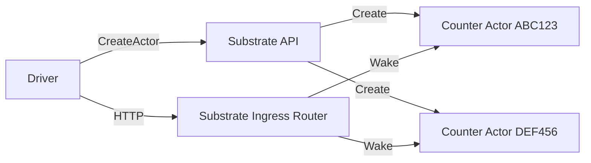

# Counter Demo

Counter is a simple demo of Substrate functionality, but with a realistic
architecture.  It's a good starting point for developing your own
Substrate-based system.



It consists of two custom components:
* The driver (built from demos/counter/driver), which is a standard Kubernetes
  application that uses the Substrate API to create actors deriving from an
  actor template, and then communicate with them through the Substrate ingress
  router.  In a real application, this would be where you do your workflow or
  user orchestration, but in this demo it just creates an actor and then
  repeatedly wakes it, calls it, and then suspends it.
* The actor (built from demos/counter/actor), which is the container that runs
  inside the actor boundary.  Normally this might be an agentic harness or a
  code sandbox execution server, but for this demo it is a small HTTP server
  that keeps an in-memory incrementing counter.

The demo has a mix of Substrate and Kubernetes config objects to make it work:
* The K8s objects in counter-k8s.yaml.tmpl include a namespace, WorkerPool CRD,
  and the driver deployment.
* The Substrate actor template is defined in counter-substrate.yaml.tmpl

## How to Run on Agent Substrate

### 1. Build and Deploy

The easiest way to get started is to create a local Kind cluster and deploy the
demo on it.

```bash
./hack/create-kind-cluster.sh
KO_DOCKER_REPO=localhost:5001 go run ./cmd/ate-setup deploy ate-system --credential-provider='{"name": "k8s.io"}' --kind
KO_DOCKER_REPO=localhost:5001 go run ./cmd/ate-setup deploy demo counter --kind
```

Alternatively, you can use the install script to deploy the demo on an existing Substrate deployment, but you will need to use the install script's configuration variables to properly set the registry, storage backend, and other settings:
```
go run ./cmd/ate-setup deploy demo counter
```

### 2. Inspect the running demo

Now that the demo is deployed, you can see it in operation.

Read the logs from the driver pod:
```bash
kubectl logs -n ate-demo-counter -l app=counter-driver
```

You can see the driver pod creating the actor, then sitting in a loop calling the actor through the router (which wakes it up from suspended state), then putting the actor back to sleep.  Each time the driver pod calls the actor, it logs the response body that the actor sends, which shows that Substrate is preserving the counter (which is only kept in actor memory, not written to a database anywhere) across suspensions.  This works even if the actor is not resumed on the same machine where it was suspended.

### 3. Uninstall

```
go run ./cmd/ate-setup delete demo counter
```
