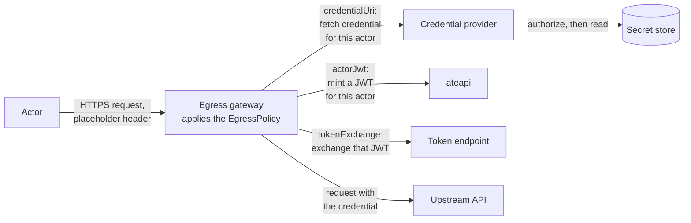

# Egress credential injection

Egress credential injection puts a secret into an actor's outbound HTTPS
requests without the actor ever holding it. It works on HTTPS the egress
gateway intercepts: an `https` rule in the actor's `EgressPolicy` has the
gateway terminate the actor's TLS for the names it lists and re-originate it
(see [egress-trust-bundle.md](egress-trust-bundle.md)). When that rule carries
a `replace_headers` effect and the actor's request includes a header it names,
the gateway resolves the referenced credential from a **credential provider**
and replaces the header's value with it (for example
`Authorization: Bearer <token>`) before the request leaves the cluster.

The actor never holds the secret. It sends the header with a placeholder
value, which the gateway discards, so it cannot read, snapshot, or exfiltrate
the secret, nor choose the value that leaves the cluster.

The gateway can also inject an **actor JWT** in place of a stored secret: a
token that ateapi mints for the actor making the request, which an upstream
that trusts Substrate's issuer can verify. See [Actor JWTs](#actor-jwts). Or
it can exchange that JWT at an OAuth 2.0 token endpoint and inject the access
token it gets back. See [Token exchange](#token-exchange).


## When you need this

Actors call APIs that need bearer tokens or API keys, and those secrets must
stay out of the actor's filesystem, environment, and snapshots. Other APIs
need to know which actor is calling and accept a signed token that says so;
for those, inject an actor JWT. APIs that take their own OAuth access tokens,
such as Google Cloud's, can get one for the actor through token exchange.

Injection is supported on HTTP and HTTPS requests allowed by an `http` or
`https` rule with credential replacement effects. For HTTPS, the actor must
trust the gateway CA — see [egress-trust-bundle.md](egress-trust-bundle.md).

## How it works



1. The actor makes an HTTPS request, sending the header the policy names with
   a placeholder value. For a name an `https` rule lists, the gateway
   terminates the actor's TLS — the actor trusts the gateway CA through a
   projected trust bundle — and decides the decrypted request against the
   actor's `EgressPolicy`.
2. If the deciding rule has `replace_headers` and the request carries one of
   those headers, the gateway asks the credential provider for the credential
   that header names.
3. The provider decides whether that actor may have that credential, reads it
   from its secret store, and returns it. The provider is the **only**
   component in the path with access to secret storage — the gateway never
   reads secrets at rest.
4. The gateway replaces the placeholder with the credential and sends the
   request on to the origin over a new TLS connection.

For an actor JWT, steps 2 and 3 go to ateapi instead of a credential provider:
the gateway asks ateapi to mint a token for the actor, or reuses one it minted
earlier. For a token exchange, the gateway then posts that JWT to the token
endpoint and injects the access token it returns.

The reference k8s secret provider, `cmd/credential-provider/kubernetes-secrets`, resolves
Kubernetes Secrets and is the one [For cluster admins](#for-cluster-admins)
deploys.

## The policy

Injection is declared in the `effects` of an `http` or `https` rule. This policy allows
HTTPS to `api.example.com` on port 443, the default, and replaces the actor's
`Authorization` header with a credential:

```bash
rules:
- https:
    hostnames: ["api.example.com"]
    effects:
      replaceHeaders:
      - header: Authorization
        prefix: "Bearer "
        credentialUri: ate-secret://k8s.io/default/ns1/example-api/token
```

The actor then sends the header with any placeholder value:

```bash
curl -H 'Authorization: placeholder' https://api.example.com/v1/items
```

This URI names the sample Secret deployed under [Enable it](#enable-it). The
sample namespace policy lets only actors in atespace `team-a` resolve it; an
actor in any other atespace gets a 403 until a cluster admin grants its
atespace access.

* `header` names the request header to replace.
* `prefix` is prepended verbatim to the credential — include the separator,
  e.g. `"Bearer "` with the trailing space.
* `credentialUri` names the credential; see [Credential URIs](#credential-uris).
* An entry sets exactly one of `credentialUri`, `actorJwt`
  ([Actor JWTs](#actor-jwts)), and `tokenExchange`
  ([Token exchange](#token-exchange)).

### Credential URIs

A credential URI has the form `ate-secret://<provider-class>/<path>`: the host
names the provider that resolves it, and the path is that provider's to
interpret. A URI the provider refuses denies the request with 403.

* **Kubernetes Secrets** (provider class `k8s.io`) — see
  [The reference provider](#the-reference-provider).
* **Google Cloud Secret Manager** (provider class
  `secretmanager.googleapis.com`) — see its
  [README](../internal/plugins/gcp-secret-manager/README.md#credential-uris).

### Actor JWTs

An entry can set `actorJwt` in place of `credentialUri`. The gateway then puts
the prefix and a JWT that ateapi minted for the actor into the header. No
credential provider is involved, so this works on a gateway installed with
`--credential-provider='{"enabled":false}'`.

```yaml
rules:
- https:
    hostnames: ["api.example.com"]
    effects:
      replaceHeaders:
      - header: Authorization
        prefix: "Bearer "
        actorJwt:
          audiences: ["https://api.example.com"]
          expirationSeconds: 900
```

* `audiences` become the token's `aud` claim: 1 to 16 distinct values, each
  up to 512 characters. Use the value the upstream checks the audience
  against.
* `expirationSeconds` is the token's lifetime, from 300 to 3600 seconds, with
  no default.

The token's `sub` is `actor/<atespace>/<actor-name>`, and its `iss` is the
issuer the install gave ateapi (`ACTOR_JWT_ISSUER`). It also names the actor's
atespace, name, and UID. ateapi signs it with the install's actor JWT signing
key, which `kubectl ate admin` rotates (see the
[kubectl-ate README](../cmd/kubectl-ate/README.md)).

The gateway reuses a token for the same actor, audiences, and lifetime until a
third of its lifetime is left, so the upstream always gets a token with at
least that much time remaining: 300 seconds for the 900-second lifetime above.
Concurrent requests that need the same token share one mint.

### Token exchange

An entry can set `tokenExchange` instead. The gateway mints an actor JWT,
exchanges it at an OAuth 2.0 token exchange endpoint
([RFC 8693](https://www.rfc-editor.org/rfc/rfc8693)), and puts the prefix and
the returned access token into the header. Like `actorJwt`, it needs no
credential provider.

```yaml
rules:
- https:
    hostnames: ["sts.googleapis.com"]
- https:
    hostnames: ["storage.googleapis.com"]
    effects:
      replaceHeaders:
      - header: Authorization
        prefix: "Bearer "
        tokenExchange:
          tokenUrl: https://sts.googleapis.com/v1/token
          audience: //iam.googleapis.com/projects/123/locations/global/workloadIdentityPools/ate/providers/actors
          scopes: ["https://www.googleapis.com/auth/cloud-platform"]
```

* `tokenUrl` is the endpoint, up to 2048 characters: an `https` URL with a
  DNS hostname and no userinfo, query, or fragment. An `https` rule in the
  same policy must allow its host and port, which is 443 unless the URL names
  one. ateapi rejects a policy without one, and the gateway checks again on
  each request, which is why the first rule above exists.
* `audience` becomes the actor JWT's only `aud` and the request's `audience`
  parameter, up to 512 characters.
* `scopes` is optional: up to 16 distinct values, each up to 256 printable
  ASCII characters without spaces, `"`, or `\`. They go in one
  space-separated `scope` parameter.
* A policy can have at most 16 `tokenExchange` entries.

The gateway posts an RFC 8693 request with
`grant_type=urn:ietf:params:oauth:grant-type:token-exchange` and
`requested_token_type=urn:ietf:params:oauth:token-type:access_token`. The
`subject_token` is an actor JWT with a 300-second lifetime, of type
`urn:ietf:params:oauth:token-type:jwt`. The gateway sends no client
credentials and no `actor_token`, so it works only with endpoints that accept
an unauthenticated exchange. Endpoints that require client authentication
aren't supported, and neither are AWS STS and Microsoft Entra, which use their
own protocols. The gateway follows no redirects and ignores proxy environment
variables. It accepts a response only with a non-empty `access_token` of
printable ASCII and, when `issued_token_type` is present, the access token
type. It verifies the endpoint against the system roots, plus any CA an admin
adds (see [Private token endpoints](#private-token-endpoints)).

The gateway reuses an access token for the same actor, `tokenUrl`, `audience`,
and scopes until a third of its lifetime or 30 seconds remains, whichever
comes first, and for 60 seconds when the response has no `expires_in`. It
doesn't cache a token with 30 seconds or less to live. Concurrent requests
that need the same token share one exchange. A request waits at most four
seconds for it, but the exchange keeps going for up to ten, so a slow
endpoint still fills the cache for the next request.

#### Google Cloud Workload Identity Federation

Google Cloud's Security Token Service accepts an unauthenticated exchange. To
use the policy above:

1. Create a workload identity pool and an OIDC provider whose issuer is the
   actor JWT issuer, set by the `actorJWT.issuer` install setting (see
   [operator-install.md](operator-install.md)). Google Cloud reads the signing
   keys through the issuer's discovery document. If the issuer isn't publicly
   reachable, as the default `https://idp.<namespace>.svc` isn't, upload the
   JWK set from `<issuer>/openid/v1/jwks` instead. An upload holds at most 8
   keys and replaces the previous one, so upload again after
   `kubectl ate admin add-jwt-key` and before activating the new key (see the
   [kubectl-ate README](../cmd/kubectl-ate/README.md)).
2. Allow the audience
   `//iam.googleapis.com/projects/<project-number>/locations/global/workloadIdentityPools/<pool>/providers/<provider>`
   as a custom audience of the provider, and use the same string as
   `audience`. The gateway sends it as both the JWT's `aud` and the STS
   `audience` parameter, which takes this form.
3. Map `google.subject=assertion.sub` and
   `attribute.atespace=assertion.sub.split("/")[1]`. Google Cloud limits
   `google.subject` to 127 characters, while the `sub`,
   `actor/<atespace>/<name>`, can reach 133: atespace and actor names can
   each be 63. The mapping works only when the atespace and actor name total
   120 characters or less. Longer ones fail the exchange.
4. Grant roles to
   `principal://iam.googleapis.com/projects/<project-number>/locations/global/workloadIdentityPools/<pool>/subject/actor/<atespace>/<name>`
   for one actor, or to
   `principalSet://iam.googleapis.com/projects/<project-number>/locations/global/workloadIdentityPools/<pool>/attribute.atespace/<atespace>`
   for an atespace. Don't grant the whole pool. Any atespace can have the
   gateway mint its actors a JWT for any audience, so the audience doesn't
   keep other tenants out.

STS requires a scope, such as `https://www.googleapis.com/auth/cloud-platform`.
It returns a federated token, which works with services that support direct
resource access. The gateway doesn't impersonate a service account.

## What the gateway does

| Situation | Outcome |
|---|---|
| Request decided by an `http` or `https` rule, carries the header, provider configured, credential resolves | Header value replaced with the credential; request re-originated upstream |
| Request decided by an `http` or `https` rule, does not carry the header | Forwarded unchanged; no credential is fetched |
| Request decided by an `http` or `https` rule, carries the header, no provider configured (`--credential-provider='{"enabled":false}'`) | **500** (Envoy) or **403** (agentgateway), fail closed |
| Secret missing, or namespace not authorized for the atespace | **403**, fail closed |
| Provider unreachable or timed out | **503**, fail closed but retryable |
| Provider returns an empty credential, or one containing control characters | **503**, fail closed |
| URI names a provider class this gateway does not serve; unusable header name; unparseable URI | **500** (Envoy) or **403** (agentgateway), fail closed |
| Request decided by an `http` or `https` rule, carries the header of an `actorJwt` entry, mint succeeds | Header value replaced with the prefix and the actor's JWT, with or without a provider |
| `actorJwt` entry, the actor no longer exists | **403**, fail closed |
| `actorJwt` entry, ateapi unreachable or timed out | **503**, fail closed but retryable |
| `actorJwt` entry, any other mint failure | **500** (Envoy) or **403** (agentgateway), fail closed |
| Request decided by an `http` or `https` rule, carries the header of a `tokenExchange` entry, exchange succeeds | Header value replaced with the prefix and the access token, with or without a provider |
| `tokenExchange` entry whose `tokenUrl` no `https` rule in the policy allows | **500**, fail closed, no exchange |
| `tokenExchange` entry, the actor no longer exists, or the endpoint refuses the exchange (`invalid_grant`, `invalid_target`, `unauthorized_client`, `invalid_scope`, or `access_denied` with a 400 or 401) | **403**, fail closed |
| `tokenExchange` entry, ateapi or the endpoint unreachable or timed out, including a TLS failure; the endpoint answers 429 or 5xx, or a 200 without a usable access token | **503**, fail closed but retryable |
| `tokenExchange` entry, any other endpoint answer, including other 4xx errors and redirects, or any other mint failure | **500**, fail closed |
| `tokenExchange` entry on the agentgateway dataplane | **403**, fail closed; agentgateway doesn't exchange tokens |

A request that does not carry the header skips injection. On an HTTP or HTTPS
request that carries it, any failure to produce the credential, including
having no provider, denies the request rather than letting it out without
the credential.

## For cluster admins

### Enable it

**1. The gateway.** The provider is selected when the egress gateway is
deployed, with `--deploy-ate-system` or `--deploy-atenet`, for either the Envoy
or agentgateway dataplane. The selection is required: an install that wants
no injection says so with `{"enabled":false}`.

```bash
hack/install-ate.sh --deploy-atenet --credential-provider='{"name":"k8s.io"}'
```

`--credential-provider` (or `ATE_CREDENTIAL_PROVIDER` when the flag is
absent) is a JSON object with these keys; any other key is an error:

| Key | Value |
|---|---|
| `enabled` | Defaults to `true`. `false` turns injection off, and then no other key is allowed |
| `name` | Required unless `enabled` is `false`. A DNS name: `k8s.io` for the bundled Kubernetes Secrets provider, or the name of a provider you deploy, which is the host of the `ate-secret://` URIs it serves, e.g. `vault.example.com` for `ate-secret://vault.example.com/...`. A policy URI naming any other provider fails closed |
| `address` | The `host:port` the gateway dials the provider at. Required for a provider you deploy; optional with `k8s.io`, where it defaults to the bundled provider's Service, `k8s-credential-provider.ate-system.svc:50051` |

For example:

```bash
--credential-provider='{"name":"k8s.io"}'
--credential-provider='{"enabled":false}'
--credential-provider='{"name":"vault.example.com","address":"vault-provider.ate-system.svc:50051"}'
```

**2. The provider.** With `k8s.io` the install deploys the Kubernetes Secrets
provider itself, from `manifests/egress-credential-injection/`, and waits for
it alongside the gateway. The install applies:

* the provider's ServiceAccount, its Deployment and its Service in
  `ate-system`;
* a ClusterRole and ClusterRoleBinding that let it read Secrets in every
  namespace;
* the `k8s-credential-provider-namespace-policy` ConfigMap, only when it is
  absent (see below); and
* a NetworkPolicy that admits only the egress gateway's pods
  (`app: atenet-egress`), on the provider's gRPC port. Every other connection
  to the provider pods is dropped. The NetworkPolicy takes effect only on a
  cluster whose network plugin enforces NetworkPolicy, such as GKE Dataplane
  V2, which `tools/setup-gcp` turns on by default. Elsewhere the provider's
  check of the gateway's client certificate is the only restriction.

Selecting any other provider, or `{"enabled":false}`, removes a bundled
provider an earlier install left behind, NetworkPolicy included. A provider of
your own is yours to deploy, and until something serves the configured address
every matching injection rule fails closed with 503.

The provider enforces an atespace→namespace authorization policy, the
`k8s-credential-provider-namespace-policy` ConfigMap in `ate-system`. The install creates
it empty, granting nothing, and only when it is absent, so a redeploy keeps
edits. Grant each atespace the namespaces whose Secrets it may resolve:

```bash
kubectl -n ate-system edit configmap k8s-credential-provider-namespace-policy
```

```yaml
  namespace-policy.yaml: |
    policies:
    - atespace: team-a
      allowedNamespaces:
      - ns1
```

The provider loads the policy **once at startup** and does not yet reload it,
so after editing, restart the provider:

```bash
kubectl -n ate-system rollout restart deployment/k8s-credential-provider
```

For a first smoke test, grant your actor's atespace `ns1` as above and apply a
sample secret that the URI in the sample policy resolves to:

```bash
kubectl apply -f manifests/egress-credential-injection/sample-secret.yaml
```

**3. The actors.** Actors can now add `replaceHeaders` effects to their
`https` rules, as described under [The policy](#the-policy). Each such actor
also needs the projected egress trust bundle to do TLS through the gateway at
all — see [egress-trust-bundle.md](egress-trust-bundle.md). Actor JWT and
token exchange entries need no provider; ateapi signs the JWTs with a key that
every install creates.

### Private token endpoints

The gateway verifies token exchange endpoints against the system roots. For
an endpoint with a private certificate, put its CA certificates under key
`ca.crt` in a ConfigMap in the install namespace and name it at install time:

```bash
kubectl -n ate-system create configmap token-exchange-ca --from-file=ca.crt=corp-root-ca.pem
go run ./cmd/ate-setup deploy atenet --token-exchange-ca-configmap=token-exchange-ca
```

Pass the flag with the rest of your install settings.

The installer mounts the ConfigMap into the gateway, which trusts these
certificates in addition to the system roots. The installer doesn't create
the ConfigMap, and the install fails if it or its `ca.crt` key is missing.
The setting needs the Envoy dataplane; see
[commands.md](../cmd/ate-setup/commands.md). The gateway reads the
certificates at startup, so restart it after changing the ConfigMap:

```bash
kubectl -n ate-system rollout restart deployment/atenet-egress
```

### Verify

Confirm the provider is ready and its NetworkPolicy is in place:

```bash
kubectl -n ate-system rollout status deployment/k8s-credential-provider
kubectl -n ate-system get networkpolicy k8s-credential-provider
```

Then give an actor an `https` rule for `httpbin.org` that replaces a header,
have it request `https://httpbin.org/headers` with that header set to a
placeholder, and look for the credential in the echoed response.

If the request is denied instead, the gateway logs the reason:

```bash
kubectl -n ate-system logs deployment/atenet-egress -c ext-proc | grep 'egress denied'
```

### Operational notes

**Transient 503s right after (re)deploying the provider.** The gateway keeps a
long-lived gRPC channel to the provider. If the provider's Service was deleted
and recreated, the channel can sit in connect backoff for up to a couple of
minutes before re-resolving; injection fails closed with 503 (deliberately
retryable) until it reconnects.

**Actor JWTs and exchanged tokens follow the actor's name.** The gateway
caches both by actor name. An actor that is deleted and recreated under the
same name can get its predecessor's token until that token's refresh point,
up to two thirds of its lifetime, or 60 seconds for an exchanged token without
`expires_in`. An actor JWT's UID claim then names the old actor.

**Scope of the reference provider's RBAC.** The sample deployment grants read
on Secrets cluster-wide so the policy may name any namespace; a production
deployment should scope this to the namespaces the provider is allowed to
serve (see the note in `k8s-credential-provider.yaml`).

## For credential provider developers

### The plugin API

The provider is a plugin: any gRPC service that implements
`CredentialProvider.FetchSecret` (`api/credprovider/v1/credprovider.proto`)
can back injection. To bring your own — reading HashiCorp Vault, Google Secret
Manager, or any other secret store — implement the API under your own provider
class (the URI host, e.g. `ate-secret://vault.example.com/...`), then have a
cluster admin point the gateway at it with
`--credential-provider='{"name":"vault.example.com","address":"<host>:<port>"}'`.
A gateway currently fronts **one** provider:
a policy URI naming any other class fails closed rather than being sent to the
wrong provider.

The gateway reads only the URI host, to confirm the URI targets the provider it
serves. Everything after the host is the provider's to interpret.

`internal/plugins/gcp-secret-manager` is such a provider for Google Cloud Secret Manager.

**Trust model.** The gateway dials the provider over mTLS with its own pod
identity, `spiffe://cluster.local/ns/ate-system/sa/atenet-egress`, and every
`FetchSecretRequest` carries the SPIFFE ID of the actor the gateway verified.
A provider should:

* accept only callers presenting the gateway's identity — the reference
  provider requires a client certificate chaining to the pod-identity trust
  bundle and pins that URI SAN on every connection; and
* enforce an actor-scoped authorization on the asserted actor SPIFFE ID — the
  gateway attests *which* actor is asking, but what that actor may resolve is
  the provider's decision.

**Status codes.** The gateway maps a `FetchSecret` failure onto the actor's
request: `NotFound` and `PermissionDenied` deny with 403 (retrying cannot
succeed); `Unavailable` and `DeadlineExceeded` fail closed with a retryable
503; any other code denies with 403.

### The reference provider

`cmd/credential-provider/kubernetes-secrets` is a working example to start
from. It resolves URIs of the `k8s.io` class,
`ate-secret://k8s.io/default/<namespace>/<secret>/<key>`, to Kubernetes Secret
values, and enforces a **default-deny atespace→namespace policy**, read from
the `k8s-credential-provider-namespace-policy` ConfigMap: an actor's atespace
may only resolve Secrets in namespaces explicitly granted to it.

## See also

* [egress-trust-bundle.md](egress-trust-bundle.md) — the actor-side trust
  projection needed for HTTPS injection.
* `demos/egress/README.md` — how tunneled egress, actor identity, and policy
  authorization fit together.
* `api/credprovider/v1/credprovider.proto` — the provider plugin API and
  its trust model.
* `cmd/credential-provider/kubernetes-secrets` — the reference provider.
* `internal/e2e/suites/egresscredinject` — the e2e suite that proves the
  behavior table above on both sandbox classes, against a cluster installed
  with `--credential-provider='{"name":"k8s.io"}'`.
