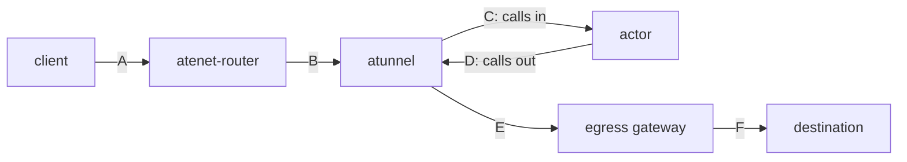

# Kernel socket memory in the networking data path

This is the first phase of
[#3133](https://github.com/agent-substrate/substrate/issues/3133). It covers
memory that piles up in the kernel when a reader is slow, in atunnel,
atenet-router and the egress gateway, and the socket options that limit it.

## The problem

atunnel, the router and the egress gateway are proxies. Each one reads data
from one connection and writes it to another.

If the reader at the far end stops reading, the data has nowhere to go. It
waits inside the proxy, in the kernel's socket buffers. That memory counts
toward the proxy's container memory limit, but it doesn't show up in heap
profiles or Envoy's statistics. With enough slow readers, the proxy goes over
its limit and is OOM-killed, and all traffic through it stops.

## The data path

There are two paths through the proxies. Each letter is one TCP connection:



* Ingress: a client calls the actor, over A, B and C.
* Egress: the actor calls something outside, like an API, over D, E and F.

C and D both join atunnel and the actor, but they are separate connections.
On C, the actor answers a call; on D, the actor makes one. Arrows point from
the side that opens the connection. Each connection carries the request
along the arrow and the response back.

A proxy has its own socket on each connection it touches: the router on A and
B, atunnel on B, C, D and E, the gateway on E and F.

## How a slow reader fills memory

A proxy holds two sockets for each flow, one toward each side. For example, a
client calls the actor, the actor answers with a large response, and the
client reads it slowly. The response comes back over C, B and A. atunnel
reads it from its socket on C and writes it to its socket on B.

Each socket has two queues in the kernel:

* The send queue holds data the proxy wrote that hasn't been delivered yet.
* The receive queue holds data that arrived that the proxy hasn't read yet.

When the client stops reading:

1. atunnel can't deliver toward the client, so the send queue of its socket
   on B fills. The kernel lets it grow to 4 MiB on GKE nodes.
2. atunnel stops reading its socket on C, so that receive queue fills. The
   kernel lets it grow to 6 MiB.

In the benchmarks this came to about 0.7 to 1.4 MiB per stalled flow.

## The options

```
send queue:     [ waiting to be sent | sent, waiting for "got it" ]
receive queue:  [ arrived, not read yet ]
```

| Option | What it limits | Cost |
|---|---|---|
| `TCP_NOTSENT_LOWAT` | data waiting to be sent | none: data already on the wire is untouched |
| `SO_SNDBUF` | the whole send queue | caps speed |
| `SO_RCVBUF` | the receive queue | caps speed |

A fixed buffer caps speed because the sender can send only one buffer's worth
before it waits for "got it". A 64 KiB buffer with a 10 ms round trip allows
about 6.4 MB/s, however fast the network is.

The options are set per socket, not as sysctls: atunnel works inside each
actor's network namespace, where a sysctl would also change the actor's own
networking.

## What we set: TCP_NOTSENT_LOWAT of 16 KiB on every proxy socket

Every proxy socket gets `TCP_NOTSENT_LOWAT` of 16 KiB (see
[the data path](#the-data-path) for the letters):

| Component | Its sockets | Set by |
|---|---|---|
| atenet-router | on A and B | `--router-tcp-notsent-lowat` |
| atunnel | on B, C, D and E | `--atunnel-tcp-notsent-lowat` |
| egress gateway | on E and F | `socket_options` and `upstream_bind_config` in `manifests/ate-install/atenet-egress.yaml` |

Set a flag to 0 to leave the kernel default. For the gateway, delete those
blocks.

atunnel sets the option on every connection it accepts. Go listens with MPTCP
where the kernel enables it, and an MPTCP listener doesn't pass the option to
the TCP connections it accepts. Envoy sets it on the listening socket. Envoy
listens with plain TCP, so the router's sockets on A and the gateway's on E
inherit it.

Setting it everywhere keeps one rule along the whole path: a slow reader
makes each proxy stop taking data, so the backlog moves back toward the
sender.

On B and E the option is on but saves no memory. One connection there carries
many requests at once, so the proxy keeps reading it for the other requests,
and a slow client's data waits in the proxy's own memory instead. That memory
needs a different fix, planned for phase 2 (see [Not covered](#not-covered)).
We leave the option on there anyway so every socket has the same setting; it
costs nothing.

No component sets fixed buffer sizes, and none has a flag for them. They cut
speed by about 90% once a few milliseconds of round trip are added (see
[Results](#results)). The fixed-buffer columns below come from builds with
`SO_SNDBUF` and `SO_RCVBUF` flags that were left out.

## Results

Kernel socket memory per stalled connection, at 100 connections, median of
three runs:

| Who stops reading | Socket that fills | Off | `TCP_NOTSENT_LOWAT` 16 KiB | Fixed 64 KiB buffers |
|---|---|---:|---:|---:|
| actor stops reading from a destination, through atunnel | atunnel on D | 753 KiB | 62 KiB | 132 KiB |
| client stops reading from an actor, through atunnel | atunnel on B | 737 KiB | 201 KiB | 257 KiB |
| actor stops reading from a client, through atunnel | atunnel on C | 1059 KiB | 580 KiB | 259 KiB |
| client stops reading from an actor, through the router | router on A | 981 KiB | 57 KiB | 132 KiB |
| destination stops reading from an actor, through the gateway | gateway on F | 1420 KiB | 48 KiB | 132 KiB |

The gateway row is one tunnel alone on its connection from atunnel. With many
tunnels sharing a connection, less piles up per tunnel.

`TCP_NOTSENT_LOWAT` empties the send queues. What's left is receive queues,
which only fixed buffers limit: that's why fixed buffers beat it on the
"actor stops reading from a client" row.

Speed over 4 connections, in MB/s, median of three runs. "+10 ms" means 10 ms
of delay added to each round trip, to act like a peer farther away:

| Who reads from whom | Delay | Off | `TCP_NOTSENT_LOWAT` 16 KiB | Fixed 64 KiB buffers |
|---|---:|---:|---:|---:|
| destination reads from an actor, through atunnel | +2 ms | 330 | 280 | 47 |
| client reads from an actor, through the router | +10 ms | 653 | 661 | 16 |
| actor reads from a destination, through the gateway | +10 ms | 309 | 308 | 10 |

Fixed buffers cut speed by 85 to 98% once delay is added. `TCP_NOTSENT_LOWAT`
stayed close to off: across all the speed tests it ranged from 16% lower to
11% higher. Single runs varied a lot, some at half speed, so a difference
smaller than that can't be told from noise.

Earlier runs tried other values: `TCP_NOTSENT_LOWAT` of 4 KiB did as well as
16 KiB, and 64 KiB kept about twice as much. Fixed 256 KiB buffers held about
400 KiB per socket whether the connection needed it or not.

## How it was measured

Two benchmarks run the components in Docker containers with memory limits:

* [benchmarking/atunnel](../benchmarking/atunnel/README.md) runs atunnel with
  the worker's own code.
* [benchmarking/envoy-sockmem](../benchmarking/envoy-sockmem/README.md) runs
  Envoy v1.39.5 configured like the router or the egress gateway. It leaves
  out their internal listeners, so its Envoy heap figures come from a shorter
  path than in a real install.

Each test opens N connections. The slow reader reads 4 MiB at full speed,
which lets the kernel grow the buffers, then stops reading. The benchmark then
reads the container's kernel socket memory: the `sock` field of
`memory.stat`. All network namespaces use GKE's TCP buffer limits. Speed tests move data over 4 connections, three runs per
setting, with delay added by netem.

The kernel also has a machine-wide limit on TCP memory, `net.ipv4.tcp_mem`,
about 6% of RAM. Past it, buffers stop growing for every socket on the
machine. In the 8 GB Docker VM that started between 200 and 400 connections,
so the results lead with 100. On a node the limit is shared by every pod, so
hitting it slows TCP for all of them.

In one atunnel run of the "off" setting the benchmark's stand-in gateway ran
out of CPU, so its queues never filled; the medians aren't affected.

These numbers come from Docker. They haven't been checked on a GKE cluster
yet.

## Not covered

These memory problems are in user space or HTTP/2 flow control, outside this
phase. They are bigger than the kernel memory and are the starting point for
phase 2:

* The router uses Envoy's default HTTP/2 window toward atunnel, 256 MiB per
  stream. When a client stops reading, Envoy can still receive up to 256 MiB
  on that stream. In the benchmark each stalled stream held about 15 MiB of
  Envoy heap and kept growing, new streams on the same connection timed out,
  and 400 stalled uploads OOM-killed Envoy at 2 GiB.
* The egress gateway holds about 1.4 MiB of heap per stalled tunnel, even
  with `per_connection_buffer_limit_bytes: 65535`.
* atunnel's HTTP/2 client to the gateway keeps Go's 4 MiB stream window,
  about 4.2 MiB of heap per stalled download.
* The gateway's 1 MiB HTTP/2 connection window is shared by all tunnels on a
  connection. A few stalled tunnels stop the others.
* The worker controller passes atunnel only its default flags, so changing an
  atunnel option on a cluster needs a controller change.
