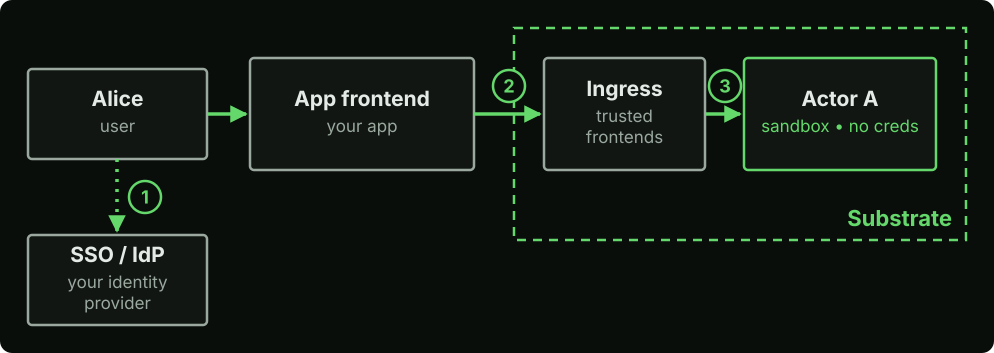
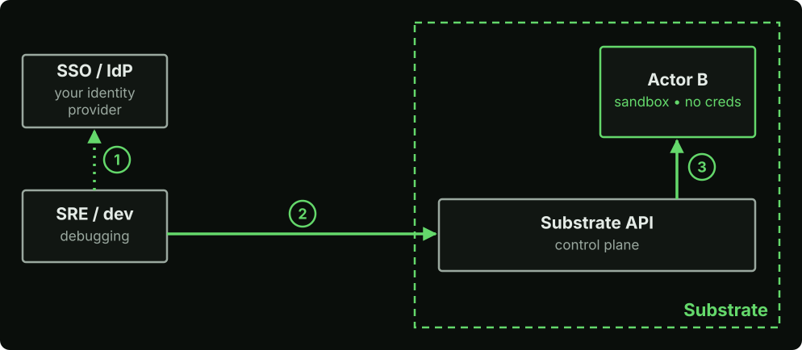
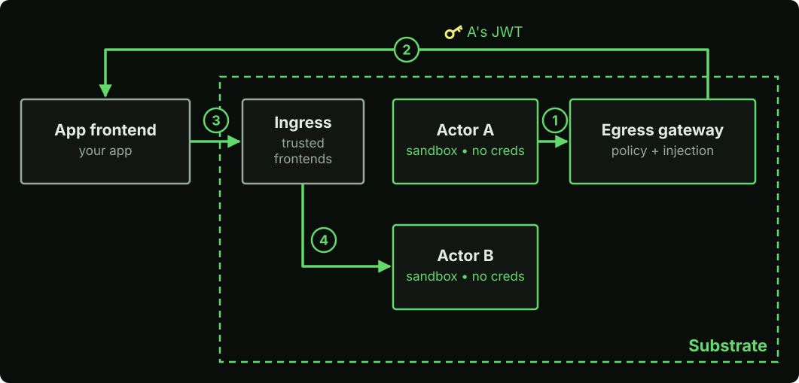
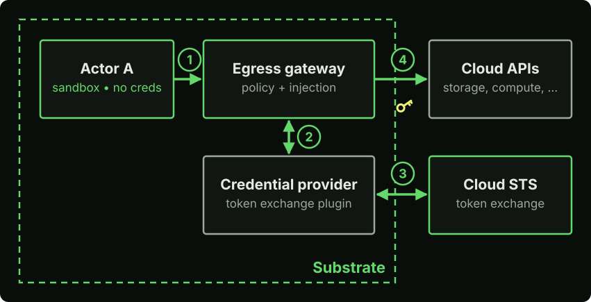
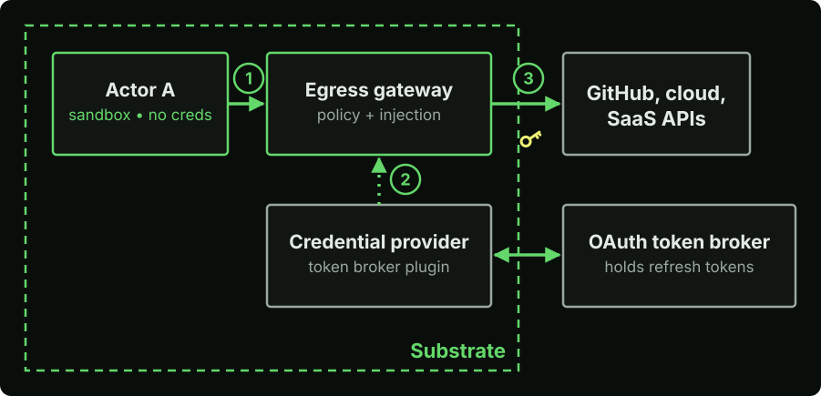

# Identity overview

Substrate identity is designed to easily integrate with external systems.
IdP-issued identities for humans are recognized by Substrate, and
Substrate-issued identities for actors are recognized by external APIs. In
this document we explain the core identity flows. More advanced identity
systems such as On-Behalf-Of
([#3715](https://github.com/agent-substrate/substrate/issues/3715)) and ID-JAG
([#3714](https://github.com/agent-substrate/substrate/issues/3714)) are being
designed.

| Flow | Credential | Issued by |
|---|---|---|
| [User → Actor](#user--actor) | The user's SSO token | Your human IdP |
| [SRE / dev → Substrate](#sre--dev--substrate) | Short-lived OIDC token | The same human IdP |
| [Actor → Actor](#actor--actor) | Actor JWT, injected at egress | Substrate |
| [Actor → Cloud](#actor--cloud) | Actor JWT, federated via OIDC | Substrate, trusted by the cloud's Security Token Service (STS) |
| [Actor → SaaS](#actor--saas-with-oauth) | OAuth access token, injected at egress | The SaaS OAuth server |

## User → Actor

1. Alice signs in to your app through your SSO. Your app frontend will make any
   necessary connections to Substrate on her behalf.
2. The frontend calls the ingress router (`atenet-router`) over mTLS. The
   router only accepts the SPIFFE IDs listed in
   [`ingressAllowedSPIFFEIDs`](../guides/operator-install.md#ingress-to-actors).
3. The router routes the request to Actor A.

Substrate does not see Alice's SSO token.

## SRE / dev → Substrate

1. The engineer gets a short-lived token from your SSO.
2. The engineer calls `ate-api-server` with the token. The server trusts your
   SSO issuer as a
   [JWT provider](../guides/authentication.md#configuring-jwt-providers), and
   [roles](../guides/authorization.md#roles) are granted per atespace.
3. The engineer can inspect, suspend, and delete actors.

## Actor → Actor

1. Actor A calls Actor B through the egress gateway (`atenet-egress`).
2. The gateway injects an [actor JWT](../guides/actor-jwts.md) for A and sends
   the request to your app frontend.
3. The frontend verifies the JWT and checks whether A may call B.
4. The frontend calls the ingress router, which routes the request to Actor B.

Actors can't reach each other directly. Your frontend authorizes every call.
The router authorizes ingress per allowlisted client today, so an allowlisted
frontend can reach every actor. Per-atespace ingress authorization will remove
the need for the hop through the app frontend and is tracked in
[#3589](https://github.com/agent-substrate/substrate/issues/3589).

## Actor → Cloud

1. Actor A sends a request with a placeholder header.
2. The egress gateway asks a token exchange credential provider for a
   credential.
3. The provider exchanges A's actor JWT at the cloud STS, which
   [trusts Substrate's issuer](../guides/actor-jwt-federation.md) through OIDC
   federation.
4. The gateway injects the cloud token.

Substrate will support native token exchange soon
([#1661](https://github.com/agent-substrate/substrate/issues/1661)). In the
meantime, you can write a token exchange credential provider using the
[credential provider API](../guides/egress-credential-injection.md#the-plugin-api).
The provider gets the actor JWT by calling `MintActorJwt` with its own
SPIFFE ID, which needs the
[`egress_gateway` role](../guides/authorization.md#system-roles)
(`--egress-gateway-spiffe-id`).

## Actor → SaaS with OAuth

1. Actor A sends a request with a placeholder header.
2. The egress gateway fetches the access token from a
   [credential provider](../guides/egress-credential-injection.md). The
   provider gets it from an OAuth token broker, which holds each user's
   refresh token. You can implement the broker yourself, or use one provided
   by a cloud provider.
3. The gateway injects the token.
