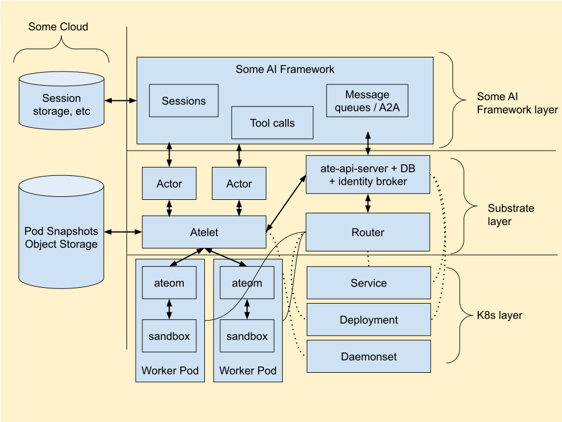

# Substrate Threat Model

Last updated: Oct 29, 2026

# Overview

Agent Substrate orchestrates stateful AI agents at high scale and density on Kubernetes, multiplexing untrusted, mutually hostile actors across a shared pool of worker Pods while maintaining sub-second cold-start and snapshot resume latency. Because actors execute untrusted code and migrate across physical infrastructure, Substrate enforces VM-grade sandboxing (`gVisor` and `Cloud Hypervisor` microVMs), per-actor cryptographic identity (`SPIFFE` X.509 certificates and JWTs), zero ambient credentials inside sandboxes, default-deny networking with authenticated ingress and egress proxies, and relationship-based access control (`OpenFGA`).

This threat model catalogs the security threats inherent to high-density stateful agent orchestration and defines the mitigating invariants and suggested mechanisms required to neutralize each threat. See the [Security Guide](security.md) for the high-level security architecture, principles, and implementation status.

# Scope

* While shown in diagrams for reference, this threat model does not cover application-layer agent frameworks or harnesses running inside Substrate actors.
* This threat model does not cover vulnerabilities contained entirely within the underlying cloud provider, host Linux kernel, Kubernetes control plane, or upstream sandbox runtimes (`gVisor`, `Cloud Hypervisor`).

# Trust Boundaries

* The sandbox (`gVisor` or microVM) is the primary boundary between an actor and everything else.
* The worker Pod is trusted with the actors it hosts. An escape into the worker compromises those actors, and workers are not a boundary between actors, since actors move between workers on resume (T-30). The worker Pod's own confinement is defense in depth for the boundary between the worker and the node, atelet, and other workers.
* A threat that matters only after another control has failed, such as a sandbox escape or a storage compromise, is rated High priority at most.

# Architecture of Substrate

# Key Components

* **ate-api-server:** Control plane server managing actor lifecycle, scheduling, OpenFGA authorization, and credential issuance.
* **ate-controller:** Kubernetes controller managing worker pool deployments and network policies.
* **podcertcontroller:** Kubernetes controller issuing short-lived mTLS certificates for pod identity, service DNS, and database access.
* **atelet:** Per-node supervisor daemon coordinating sandbox lifecycle, checkpoint/restore, and node-attested credentials.
* **ateworker:** Per-worker Pod runtime daemon managing interior sandboxes (`gVisor` or `Cloud Hypervisor` microVMs).
* **Worker:** Pre-provisioned Pods that host active actors.
* **Actor:** The core stateful compute primitive, grouped into atespaces and scheduled onto workers via Run or Resume.
* **Actor Network:** Private per-actor network namespace and point-to-point veth link behind `atunnel`'s authenticated listener on port 443.
* **Actor Routing:** Ingress requests identify the target actor via `ate-target-actor: <atespace>/<actor>`.
* **atenet-router:** Envoy ingress proxy with an `ext_proc` processor that authenticates callers over mTLS, resolves worker assignments, and routes to `atunnel`.
* **atenet-egress:** Multi-tenant Envoy egress forward proxy that enforces declarative egress policies and injects credentials.
* **Object Storage:** Stores partitioned actor snapshots, accessed through the out-of-process `objectstore-plugin`.
* **Filesystem Support:** Container rootfs overlays and working directories captured in snapshots and wiped on actor teardown.
* **Substrate Database:** PostgreSQL (or Cloud SQL on GCP), accessed over TLS by `ate-api-server`.
* **Kubernetes:** The underlying cluster infrastructure providing node isolation and network policies.

# Threats and Mitigations

**Table Schema:**

* **Priority:** Critical, High, Medium, Low
* **Threats:** Expected risks in a naïve implementation of Substrate.
* **Mitigating Invariants:** High-level properties which, if true, mitigate the threat.
* **Suggested Concrete Mitigations:** Specific options and architectural mechanisms for implementing the mitigating invariants.
* **Notes:** Contextual notes, edge cases, and design considerations.

Implementation status is intentionally not tracked in this table. High-level principle status is maintained in the [Security Guide](security.md), while threat-by-threat mitigation quality is dynamically evaluated against the codebase by automated security review agents in CI (see `.agents/skills/security-status-report/`). Recording static status claims in this reference catalog would risk biasing automated evaluators away from independently verifying the code.

## Attacks from External Networks

Substrate is expected to sit behind the user's service, not on the internet, so these threats assume that outer layer has failed.

| Threat ID | Priority | Threat | Mitigating Invariants | Suggested Concrete Mitigations | Notes |
| :---- | :---- | :---- | :---- | :---- | :---- |
| T-01 | High | External attacker can access actors over the internet | Access to actors over the external internet is blocked by default. | ClusterIP-only Services. Default-deny ingress NetworkPolicies for ate-system and worker pools. Exposing anything outside the cluster is an explicit operator choice. Requires a CNI that enforces NetworkPolicy. | |
| T-02 | High | External attacker can access nodes over the internet | Access to nodes over the external internet is blocked by default. | No hostNetwork, hostPort, NodePort, or LoadBalancer in Substrate components. Cluster setup tooling creates private nodes. | Node firewalls are cluster configuration and outside Substrate's scope, but are recommended. |
| T-03 | High | External attacker can access Substrate API or backend database over the internet | Access to Substrate API over the external internet is blocked by default. | ClusterIP-only Services. Default-deny ingress NetworkPolicies for ate-system; only ate-api-server can reach the database. Exposing the API outside the cluster is an explicit operator choice. Requires a CNI that enforces NetworkPolicy. | |

## Attacks from Internal Network, API Clients

| Threat ID | Priority | Threat | Mitigating Invariants | Suggested Concrete Mitigations | Notes |
| :---- | :---- | :---- | :---- | :---- | :---- |
| T-04 | Critical | Access to the internal network allows arbitrary actions to be performed on ate-apiserver, atelet, substrate backend database, etc. | All system components must have basic mutual authentication and authorization, and communicate over TLS. All clients (including end users and actors) must be authenticated and authorized.  Unauthenticated traffic must be rejected. Where possible, use firewalls to block access from ranges that have no business communicating with Substrate components.  | mTLS or a UDS between components, with each caller's identity checked. Per-node identity for atelet. Ingress checks the caller's permission on the target actor before resuming or forwarding. Only ate-api-server can reach the database. Default-deny NetworkPolicies for ate-system. | |
| T-05 | High | Privilege escalation via access to sensitive labels. | If Substrate offers its own resource labeling mechanism, it must also offer a way to authorize label updates on a per-label basis. | Restrict who can change labels that drive behavior, such as the WorkerPool labels that `worker_selector` matches. Authorize label updates separately from the resource body. | Kubernetes let the /status subresource update labels. Don't repeat this. |
| T-06 | High | Attacker gains control of the Substrate API server or an ingress/egress gateway. | Isolate the control plane from the data plane, and isolate data plane ingress from sandboxes. | Run control-plane components and gateways on separate nodes from sandboxes. Block network access from workers to the control plane. mTLS between all components. | Separation also limits noisy-neighbor and reliability problems. |
| T-07 | High | Attacker who can create ActorTemplates specifies malicious runtime. | Ensure available runtime can only be configured by administrators. | Configure runtimes in admin-owned cluster resources, similar to RuntimeClass, not in ActorTemplates. | |
| T-08 | High | Attacker who can create ActorTemplates can read or write any storage buckets atelet has access to. | Ensure that bucket access is least-privilege. | Per-actor, downscoped credentials for snapshot transfers. No storage credentials on atelet or nodes. Derive storage locations internally instead of accepting arbitrary URLs. Verify asset digests. | Example: a template points its snapshot or asset URL at an internal bucket to read from it or write to it. |
| T-09 | Medium | DoS attack against API, gateway, or available cluster resources. | Minimize exposure and ensure APIs and proxies implement appropriately scoped quotas and rate limiting. | Keep the API and gateways off the internet and unreachable from sandboxes. Run control-plane components on separate nodes from sandboxes. Rate limits and quotas in the API and gateways, including per-user actor quotas. Consider an identity-aware WAF if external access is required. | Bound the API load from gateway assignment lookups during traffic floods. |
| T-10 | Medium | Internal network traffic is intercepted or spoofed | Encrypt all traffic by default | mTLS between all components, including gateway to worker. | |

## Misconfiguration Risks

| Threat ID | Priority | Threat | Mitigating Invariants | Suggested Concrete Mitigations | Notes |
| :---- | :---- | :---- | :---- | :---- | :---- |
| T-11 | High | Improper handling of Secrets | Ensure there is an official, secure, recommended way for actors to use secrets, like API access tokens, without the secret entering the sandbox. | Inject credentials at the egress gateway so secrets never enter the sandbox. | Without an official path, users put secrets in plaintext fields. |
| T-13 | Medium | Flat namespace of actors encourages broad permission grants or complex graph-oriented policy. | Support a grouping mechanism that can be used in policy controls. | Atespaces as the policy grouping unit, like Kubernetes namespaces. | |
| T-14 | Medium | DNS misconfiguration | Access to DNS configuration should be limited to authoritative controllers. Routing should use stable configurations and query the API for the current worker assignment before forwarding requests.  | Keep controllers with sensitive access off actor nodes. Limit who can update DNS configuration. Gateways get the worker assignment from the Substrate API, with bounded caching. mTLS from gateway to worker. | Invalidate cached assignments when actors move. |

## Attacks from Actors

| Threat ID | Priority | Threat | Mitigating Invariants | Suggested Concrete Mitigations | Notes |
| :---- | :---- | :---- | :---- | :---- | :---- |
| T-15 | Critical | Malicious actor gains access to the underlying node or other actors via container breakout (Linux local privilege escalation) | Actors are always sandboxed using a hardened sandbox solution like gvisor or microvm. Traditional containers are not a secure sandbox.  | gVisor or microVM sandboxes. Defense in depth around the sandbox runtime: user namespace, pivot_root, seccomp, minimal capabilities. Low-privilege sidecars. Control sandbox lifecycle from outside the sandbox. | |
| T-16 | Critical | Malicious actor gains access to the underlying node via node-local endpoints exposed on the network | Network policies must prevent the actor from accessing system services on the node (e.g. instance metadata, host network namespace, host network interface). | Per-actor network namespace, no host network access. Block node-local services such as instance metadata. Targeted ingress policies on host services. | |
| T-17 | Critical | Malicious actor gains access to other actors via network | Network policies must deny ingress and egress by default, and selectively allow access to specific actors only when necessary. Network policies must be synchronized with actor lifecycle. | Default-deny traffic between actors, enforced by the worker so policy updates are fast. | |
| T-18 | Critical | Malicious actor gains access to the underlying node or other actors via filesystem | Filesystem access is limited to the actor's local fs and remote filesystems the actor is directly, explicitly authorized to access. | Isolate actor filesystems with user namespaces or per-actor UIDs. Guard filesystem setup and APIs against symlink, mount, and path traversal. | Vectors: file-read bugs, symlink and path traversal, OCI image unpacking, shared directories on root or privileged workers. |
| T-19 | Critical | Malicious actor gains access to the underlying Worker Pod or node via local Substrate services (atelet, ateworker, etc).  | Actor access to system services must be denied or explicitly scoped to the actor. Local services must run with the fewest privileges possible to limit the ability for an actor to escalate privilege. | Limit actor access to local services. Local services authenticate the actor and authorize by its identity. | |
| T-20 | Critical | Malicious actor gains access to the underlying node or other actors via Substrate APIs (remote ate-apiserver) | Either actors are completely unable to access Substrate APIs, or actor access is authenticated and authorized such that the actor cannot escalate beyond its intended scope. Especially prevent self-modification, which was a common escalation path in K8s. | Don't let actors or workers modify themselves, e.g. read or write their own snapshots or change their own labels. Keep resource-modifying logic in the control plane. | |
| T-21 | High | Attacker who has escaped the sandbox escalates to the node, atelet, or other workers via excessive Worker Pod permissions | Worker Pods hold only the permissions sandbox lifecycle needs, and each permission beyond the container defaults has a documented reason. A worker can't modify or execute anything that atelet or other workers trust. | Run worker Pods non-root or in a user namespace, unprivileged, with only required capabilities and devices. A tailored seccomp profile instead of Unconfined. No ServiceAccount token. Mount only the worker's own host paths, read-only where it doesn't write. Verify shared assets before every use. | Rated High priority because it requires a sandbox escape first (T-15). Until workers run in their own user namespace, they may run as root, hold the capabilities the sandbox runtime needs (for example, `SYS_ADMIN` for mounts and `pivot_root`, and `NET_ADMIN` to build the actor network), and run with AppArmor Unconfined, because the default profile denies `mount`. By design, a worker can observe and modify the actors it hosts (such as pause containers that share a cgroup). |
| T-22 | Critical | Malicious actor gains access to the underlying node or other actors via Kubernetes APIs  | Either actors are completely unable to access the Kubernetes APIs, or actor access is authenticated and authorized such that the actor cannot escalate beyond its intended scope. **Strong preference on blocking actor access to Kubernetes.** | Block network access to the Kubernetes API. Give worker Pods no service account token, or one with no privileges. | |
| T-23 | Critical | Malicious actor workload gains access to snapshots of other actors and steals data from them. | Worker Pods and actors must not have direct access to snapshots. | Make snapshot credentials usable only by atelet, via extra claims or binding to atelet's mTLS. Envelope encrypt snapshots, keyed to actor identity. Avoid snapshotting credentials. | |
| T-24 | Critical | Malicious actor workload overrides snapshots of other actors with malicious snapshots. | Worker Pods and actors must not have direct access to snapshots. | Make snapshot credentials usable only by atelet, via extra claims or binding to atelet's mTLS. | |
| T-25 | Medium | Malicious snapshot is restored | Cryptographically verify each snapshot before restoration | Check snapshots against a trusted digest or signature before restore. Deliver the digest or key over a trusted channel. | Rated Medium priority because it requires control of snapshot storage, or of the path to it, which is a failure of other controls (T-23, T-24, T-36). Those with that access are mostly storage administrators, as in T-39. |
| T-26 | Critical | Stale policies propagated out-of-band with actor scheduling result in incorrect access boundaries (including network policies, IAM permissions, etc.) | An actor's network and authorization policy is in effect before it starts running. Enforcement points may cache policy, as long as a policy change takes effect within a short time. An enforcement point that can't get current policy denies rather than serving stale policy indefinitely. | Program authz and network policy as part of actor create and resume, or fetch it on first use and deny until it arrives. Short cache TTLs. Invalidate caches on policy change where it's cheap. | Caching is required for performance, since enforcement points check policy on every connection or query. Operators may tune cache TTLs. Policy applies to new connections; a policy change doesn't cut connections that are already open. Credentials already issued are limited by their own lifetime (T-28), not by policy propagation. |
| T-27 | Critical | Worker reuse enables malicious actor to escalate to other actors by persisting a threat across reuse, reading leftover state from a previous actor, or taking advantage of stale policy configuration.  | All actor-specific worker state, including process state, filesystem, env vars, mounted config, network policy, and security policy, must be completely reset between actors that subsequently run on the same worker.  | Synchronize local policy updates with actor lifecycle. Test cleanup across suspend/resume for each sandbox type, with honeypots on both sides. | |
| T-28 | Critical | Malicious actor tricks Substrate identity broker into returning identity credentials for a different actor. | Add defense-in-depth to ensure that credentials cannot be mis-issued, and that mis-issued credentials are unusable in practice.  | Check the actor's worker assignment before issuing credentials. Bind credentials to the worker and node, check those claims in authz, and invalidate old credentials on reschedule. | |
| T-29 | High | Agent leaks credentials exposed in sandbox, because LLMs are unreliable. Due to prompt injection or just agent silliness. | Credentials are not exposed in sandboxes by default. | No credentials in sandboxes by default. Inject credentials at a proxy. Delegate to drivers (like CSI) rather than sandboxed clients. Credentials that must enter the sandbox are wrapped and only usable through the proxy. | Exposing credentials can be opt-in when the process is not an AI agent or can't read them. |
| T-30 | Medium | Malicious actor moves laterally to other nodes via suspend/resume, especially if self-suspend is allowed. | Actor isolation doesn't depend on which node an actor runs on. Admins can confine actors to specific node pools. | Let admins restrict which node pools an actor can resume on. | Actors move between workers by design, so nodes aren't a boundary between actors. This only matters combined with a sandbox, network, or filesystem escape. |
| T-31 | High | DoS/resource exhaustion via malicious container image | Enforce limits when pulling and extracting container images | Limit uncompressed layer size and unpack time. | Example: a zip bomb. |
| T-32 | Medium | Compromised process inside actor uses actor identity to write its own snapshot, enabling local privilege escalation (still in actor sandbox). | Issue separate credentials for accessing snapshots. | Snapshot access requires an extra claim, audience, or second identity proving atelet is acting for the actor. | Medium because it's still a local exploit inside the sandbox. Example: a nonroot process rewrites the snapshot so it can `su` to root after restore. |
| T-33 | Medium | Attacker creates a large number of malicious actors to rapidly spread across the cluster or exhaust resources (via direct create or fork-bomb equivalent). | Limit resource consumption and number of child actors for each actor.  | Make actor creation a privileged permission. Rate limits and quotas that count child actors and their resources, attached to atespaces. | |
| T-34 | Medium | Attacker discovers Kubernetes-internal network topology from inside sandboxed actor | Don't allow actors to explore the cluster network | Don't expose cluster DNS to actors. Give actors their own resolv.conf, not the worker Pod's. | |
| T-35 | Low | Attacker discovers enough information about actor names or namespace names to be consequential, from inside a sandboxed actor. | Only expose actor names for peers the actor needs to interact with. | Don't expose Substrate-internal DNS to actors by default. | What an actor can send traffic to matters more than the names it learns. |

## Attacks from Nodes

| Threat ID | Priority | Threat | Mitigating Invariants | Suggested Concrete Mitigations | Notes |
| :---- | :---- | :---- | :---- | :---- | :---- |
| T-36 | High | A compromised node accesses all snapshots for the cluster. | Node access to snapshots must be scoped to actors actively scheduled to the node. | Per-actor snapshot credentials, issued only to the node the actor is scheduled on and downscoped to that actor's snapshots. No node-wide storage role. Write-once snapshot versions. Wipe previous actors' data from the node on suspend. | Detecting nodes that request snapshots for actors not scheduled on them adds defense in depth. |
| T-37 | High | Compromised node accesses filesystem storage for actors on other nodes. | Node access to network filesystems must be scoped to actors actively scheduled to the node. | Per-actor filesystem credentials, issued only to the node the actor is scheduled on. | Depends on what the network filesystem supports. |
| T-38 | High | Compromised node can escalate to other nodes or control plane via Substrate or Kubernetes. | Node access to Substrate or Kubernetes APIs must be scoped to operations relevant to actors actively scheduled to the node, and to the node itself. | Scope atelet's API access to actors on its node. Tight NetworkPolicies between data-plane and control-plane components. Limit what node identities can do in Kubernetes, as NodeRestriction does. | |

## Insider Attacks

| Threat ID | Priority | Threat | Mitigating Invariants | Suggested Concrete Mitigations | Notes |
| :---- | :---- | :---- | :---- | :---- | :---- |
| T-39 | Medium | Insider access to snapshots | Substrate's storage models for snapshots must enable users to grant granular access control when needed for system administration, rather than only supporting broad access across all actors. | Encrypt snapshots so storage is untrusted and only the node running the actor can decrypt them (T-23). A storage layout that maps to per-actor identity, so access can be granted per actor. | |
| T-40 | Medium | Insider access to disks, e.g. for substrate backend DB | Support envelope encryption of sensitive data, or avoid storing sensitive data. | Full-disk encryption, which most clouds enable by default. Keep secrets out of Substrate's database, and envelope encrypt any that must be stored, with HSM-backed keys. | Credentials are injected at egress, not passed to actors (T-29), so actor specs such as environment variables are not a place for secrets. |

## Detection and Response

| Threat ID | Priority | Threat | Mitigating Invariants | Suggested Concrete Mitigations | Notes |
| :---- | :---- | :---- | :---- | :---- | :---- |
| T-41 | High | Malicious actions are not recorded for forensics.  | Enable audit logging for all Substrate components that serve APIs, including node-local components. | Every component that serves an API or accesses snapshot storage logs each request with the caller's identity, so the cluster's log collection captures it. | Data-access logs on busy snapshot buckets are impractical, so rely on logs from the components allowed access. |
| T-42 | Medium | Malicious activity proceeds undetected. | Enable integration with threat detections systems. | Pluggable threat detection fed by telemetry from the API, node components, and sandboxes. Optional per-node or per-worker security sidecars. | |
| T-43 | Medium | Detected malicious actor cannot be contained. | Quarantine or suspension option. | Dynamic policy updates for fast quarantine. Snapshot and suspend on detection, and taint the snapshot so it can't resume automatically. | |
