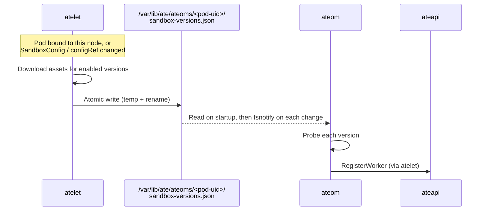

# Worker sandbox versions: delivery and refresh

Part of #587. Builds on #2393 (`WorkerPool.status.sandboxClasses[].configRef`) and #2381 (`SandboxRuntime` / `default_runtime` / `restorable_runtimes`).

## Summary

Current state:

* atelet downloads all sandbox assets. The prewarmer ([`startSandboxAssetPrewarm`](../cmd/atelet/sandbox_prewarm.go#L118)) downloads every enabled version of every SandboxConfig; the download logic lives in [`ensureSandboxAssets`](../cmd/atelet/sandbox_assets.go#L154)
* Downloads land in the content-addressed directory `/var/lib/ate/static-files/` ([`nodepath.StaticFilesDir`](../internal/nodepath/nodepath.go#L31)):
  * gVisor releases are extracted to `gvisor-<sha256>/` ([`GVisorReleaseDir`](../cmd/atelet/internal/ateletpath/ateletpath.go#L48))
  * Single-file assets are stored at `runsc-<sha256>` ([`RunSCBinaryPath`](../cmd/atelet/internal/ateletpath/ateletpath.go#L39))
* ateom reads these paths through a hostPath mount, but atelet only gives them to it in Run / Restore requests (`RunWorkloadRequest.runsc_path` / `runtime_asset_paths`, [`ateom.proto`](../internal/proto/ateompb/ateom.proto#L150))
* At registration, ateom doesn't know which SandboxConfig its pool uses and has no assets, so it can only report `sandbox_class` and `architecture`

Proposal:

* For each worker pod on its node, atelet maintains a versions file `/var/lib/ate/ateoms/<pod-uid>/sandbox-versions.json` listing every enabled version in the SandboxConfig of the pod's pool, with its local asset paths. The file is refreshed the same way Kubernetes refreshes projected volumes (ConfigMap / Secret / ServiceAccount token): when the content changes, the writer replaces the file atomically on the node, and the consumer watches the file and reloads
* New worker pods: atelet writes the file as soon as the pod is bound to its node. Once ateom starts, it reads the file, probes each version, and registers
* Existing worker pods: when a SandboxConfig or a WorkerPool's `configRef` changes, atelet first downloads the new version's assets, then replaces the file. ateom notices the change via fsnotify, re-probes, and re-registers through the existing path:
  * ateom: [`register`](../internal/ateom/register.go#L200)
  * atelet: [`AteomSupport.RegisterWorker`](../cmd/atelet/ateomsupport.go#L117), forwarded as-is
  * ateapi: [`WorkerService.RegisterWorker`](../cmd/ateapi/internal/workerservice/register.go#L37), idempotent replace
* atelet creates and deletes the `/var/lib/ate/ateoms/<pod-uid>/` directory; ateom only manages its own `ateom.sock`

New worker pods and config changes take the same path:

* Pod Add fires when the pod is bound, before its containers start (image pull and other steps come in between), so the file usually exists by the time ateom starts
* If atelet hasn't written it yet (resolution is waiting on `configRef`, or assets are still downloading), ateom waits on the watch and continues once the file appears

## Principles

* atelet delivers assets: it resolves the worker's SandboxConfig, downloads the assets, and writes each version's local paths for ateom
* ateom reports its own runtimes: it runs probes against the assets it received, assembles `SandboxRuntime`, and calls `RegisterWorker`
* atelet does not rewrite ateom's report: `RegisterWorker` authenticates and validates, then forwards it as-is
* atelet delivers versions to ateom only through the file, level-triggered: atelet writes the desired state, and whenever ateom reads it, it converges to the same result

### Why ateom reports its own runtimes

`SandboxRuntime` decides which workers a snapshot can be restored on ([`hardware.Matches`](../internal/hardware/hardware.go#L63)): the worker must have every attribute on the snapshot, with an equal value. Each version's runtime is assembled by [`buildRuntime`](../internal/ateom/runtime.go#L81) from three parts:

* `architecture`: from [`hardware.ProbeHost`](../internal/hardware/hardware.go#L48)
* The result of the class-specific probe: for gVisor this is [`runscCPUFeatures`](../cmd/ateom-gvisor/cpufeatures.go#L41), which runs that version's own `runsc cpu-features` to get the CPU feature set this runsc exposes to the guest on this machine (the result is hashed and stored as `cpu_features`). gVisor can only restore on a host that provides every feature present at checkpoint time
* `sandbox_assets_hash`: a hash of the class, the pause image, and the asset digests

ateom, not atelet, runs the probes because:

* Each class probes differently, and that knowledge stays in its own ateom binary (`ateom-gvisor` / `ateom-microvm`), so atelet doesn't need to know class details
* The probe runs in the environment that actually runs the sandbox: the same container's mount namespace, permissions, and devices. If the binary can't run inside ateom, the probe fails and that version stays out of `restorable_runtimes`, so a worker never reports a runtime it can't restore
* microVM needs `/dev/kvm`: the worker pod gets this device through a device plugin, while atelet can only check that it exists; its own cgroup device filter won't let it open the device (the `host-dev` volume in `manifests/ate-install/atelet.yaml`). The per-version microVM feature probe can only run in ateom (not yet implemented, see Out of scope)
* The report is the worker's statement of its own capabilities; atelet only authenticates and forwards it, so it doesn't need to keep a copy of ateom's probe logic

In the current gVisor implementation, `runsc cpu-features` reads CPUID, which container isolation doesn't affect, so atelet running the same runsc on the same node would in theory get the same result. ateom was chosen for the reasons above, not because atelet can't get this information.
